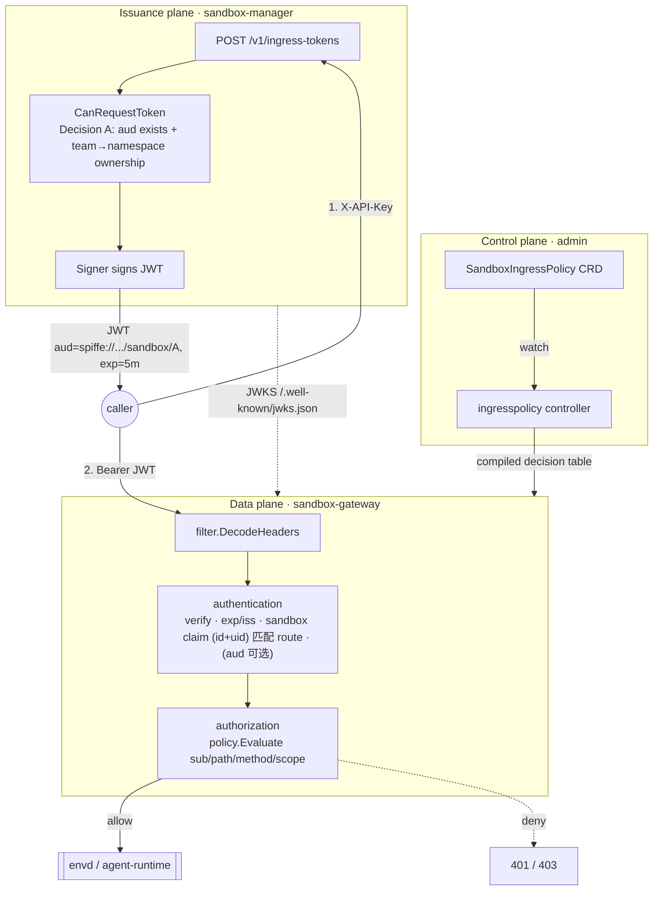
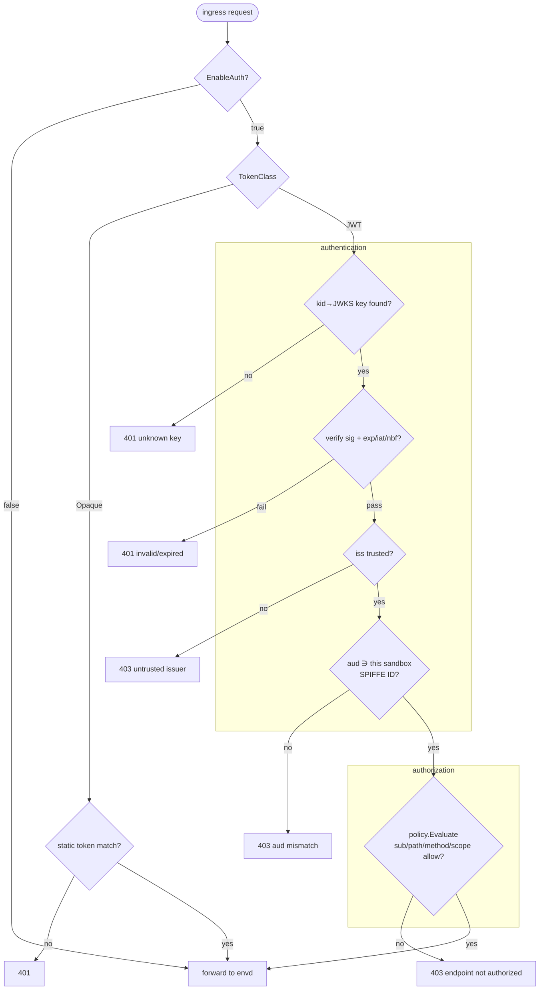
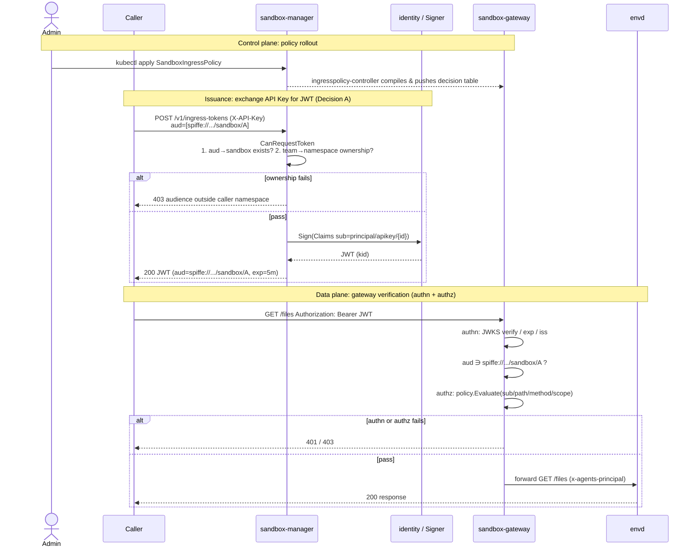

# Sandbox Ingress (envd) Token 认证与 aud 授权

> Feature gate: `SandboxIngressJWTAuth`（gateway + manager，Alpha，默认关闭）。

## 目录

- [概要](#概要)
- [动机](#动机)
- [术语表](#术语表)
- [基线（当前状态）](#基线当前状态)
- [方案](#方案)
    - [架构：三个平面](#架构三个平面)
    - [身份与 aud 语义（SPIFFE）](#身份与-aud-语义spiffe)
    - [Token 结构](#token-结构)
    - [签发流程（sandbox-manager + identity）](#签发流程sandbox-manager--identity)
        - [签发凭证：复用现有的 Team API Key](#签发凭证复用现有的-team-api-key)
        - [签发侧授权：CanRequestToken（Decision A）](#签发侧授权canrequesttokendecision-a)
        - [可插拔 Signer 详细设计](#可插拔-signer-详细设计)
        - [签发侧 SDK 设计（扩展 E2B SDK）](#签发侧-sdk-设计扩展-e2b-sdk)
    - [校验流程（sandbox-gateway filter）](#校验流程sandbox-gateway-filter)
        - [JWKS 获取与缓存](#jwks-获取与缓存)
        - [校验链：认证 + 授权](#校验链认证--授权)
    - [管理员授权：SandboxIngressPolicy CRD](#管理员授权sandboxingresspolicy-crd)
    - [双侧强制与一致性](#双侧强制与一致性)
    - [吊销与密钥轮转](#吊销与密钥轮转)
    - [端到端时序](#端到端时序)
- [用户故事](#用户故事)
- [需求](#需求)
- [风险与缓解](#风险与缓解)
- [替代方案](#替代方案)
- [升级策略](#升级策略)
- [测试计划](#测试计划)
- [实现历史](#实现历史)

## 概要

本提案为 sandbox 的**入站方向**（client → sandbox-gateway → envd/agent-runtime）
引入基于 JWT 的认证和 **audience（aud）授权**。只有当一个 token 的 `aud`
显式包含目标 sandbox 的 SPIFFE ID，并且通过了签名、过期时间和管理员策略检查时，
才能访问该 sandbox 的 envd 入站接口。

分为三个部分：

1. **签发平面**（sandbox-manager + `pkg/identity`）：用现有的 Team API Key
   换取携带 `aud` 的短时效 JWT。
2. **授权控制平面**：新增一个命名空间级 CRD `SandboxIngressPolicy`
   （与出站方向的 `SecurityProfile` 对称）。
3. **校验数据平面**（sandbox-gateway）：将当前静态的 `x-access-token`
   比对升级为分级校验链。

envd 自身保持不变。整个功能由 `SandboxIngressJWTAuth` feature gate 守护
（gateway + manager，Alpha，**默认关闭**）；关闭时，gateway 回退到当前的静态
token 行为，`SandboxIngressPolicy` CRD 处于惰性状态。它完全向后兼容
（`TokenClass=Opaque` 保留旧路径）。发布与回滚请见
[升级策略](#升级策略)。

## 动机

如今入站认证仅是 gateway 中针对每个 sandbox 的静态 `x-access-token`
常量时间比对。存在的问题：

- **无 audience 隔离**：token 是每个 sandbox 的共享密钥；一旦泄漏无法限定范围。
- **无细粒度授权**：无法将调用方限制在 envd 接口的某个子集上。
- **无标准生命周期**：没有 `exp`，没有稳定的 subject，不可吊销，无审计。

这对应到 roadmap → Runtime → *更安全的 access token 与审计*。

### 目标

- envd 入站仅接受 **aud 包含目标 sandbox SPIFFE ID** 的 token；缺失 aud 返回 403。
- 管理员以声明式方式授权"subject × sandbox × 接口/能力"。
- 短 TTL（默认 5 分钟）JWT + 本地签名校验；密钥轮转。
- 复用现有的 Team API Key 作为签发凭证、复用 `SecurityProfile` 的授权范式、
  以及 gateway filter 架构。
- 默认关闭、向后兼容、渐进式发布。

### 非目标 / 未来工作

- 不在 envd 内部做授权（未来）。
- 不做 proof-of-possession / DPoP（强不可转移性 → X.509 + mTLS，未来）。
- **第一版签发侧仅做归属检查（Decision A）**；所有细粒度的 scope/接口授权
  均由 gateway 强制执行。

## 术语表

| 术语 | 含义 |
|------|------|
| ingress | client → sandbox-gateway → envd/agent-runtime 方向 |
| envd | sandbox pod 内暴露 E2B 兼容 API 的 agent-runtime sidecar |
| **sandbox 绑定 claim** | 自定义 `sandbox` claim `{sandboxId, sandboxUid}` —— **主**授权锚点，与已合并的 verifier 及 #772 对齐 |
| **sandbox SPIFFE ID** | `spiffe://<trust-domain>/ns/{namespace}/sandbox/{name}` —— 可读的身份标签；也可作为 `aud` 用于纵深防御 |
| **caller SPIFFE ID (sub)** | `spiffe://<trust-domain>/principal/apikey/{user.ID}` —— 由 Team API Key 派生 |
| aud | JWT audience（RFC 7519 §4.1.3）：预期接收者。**可选，仅作纵深防御** —— sandbox 的范围限定由 `sandbox` claim 完成，而非 `aud` |
| scope | envd 接口级能力，例如 `envd:fs:read` |
| TokenClass | token 格式：`JWT`（新）或 `Opaque`（旧的静态 token） |
| Role A / Role B | A = 签发凭证（Team API Key，入场券）；B = 入站 token（新签发的 JWT） |

## 基线（当前状态）

> 所有事实均来自当前代码库。

| 方面 | 当前实现 | 位置 |
|--------|------------------------|----------|
| 入站认证 | 静态 `x-access-token` 常量时间比对，`EnableAuth` 默认 false | `pkg/sandbox-gateway/filter/filter.go:116` |
| 路由载体 | `Route{IP,ID,UID,Owner,State,ResourceVersion,AccessToken}`，`AccessToken` 来自注解 `agents.kruise.io/runtime-access-token` | `pkg/utils/proxyutils/route.go:39,45` |
| Sandbox 查找 | `adapter.Map` 从 authority/path 派生 sandboxID、port | `filter.go:74` |
| 签发凭证 | Team API Key（`X-API-Key`）→ `CheckApiKey` → `*models.CreatedTeamAPIKey`（含 `ID`、`Team.Name`） | `pkg/servers/e2b/routes.go:100`、`models/api_key.go` |
| 身份粒度 | team name → namespace（`getNamespaceOfUser`），admin team 为集群级 | `pkg/servers/e2b/routes.go:207` |
| Token 签发 API | `IdentityProvider.IssueToken(ctx,sbx,claim)→TokenResponse{AccessToken}`，`TokenType`=Agent/Principal | `pkg/identity/{interface,types}.go` |
| 企业版传输 | `identityProviderClient.Invoke(action,req,resp)` 通用 action 路由器，`ValidateToken/RevokeToken` 已预留 | `pkg/identity/inner/security_provider.go:513,86` |
| 物料分发模板 | `GetProxyCABundle` action + `CABundleSpec` 注册表 + lazy provider 三态分层 | `pkg/identity/inner/proxy_ca_bundle.go` |
| 出站授权范式 | `SecurityProfile` CRD：Selector + 有序 Rules + Accepted/Programmed | `api/v1alpha1/securityprofile_types.go` |

## 方案

### 架构：三个平面

```
                 ┌────────────── Control plane (admin) ──────────────┐
                 │  kubectl apply SandboxIngressPolicy (new CRD)      │
                 │        │ watch                                     │
                 │        ▼                                           │
                 │  ingresspolicy-controller ─► compile ─► gateway registry
                 └───────────────────────┬────────────────────────────┘
                                         │ policy + JWKS
 [Issuance]                              ▼
 caller ─POST /v1/ingress-tokens(X-API-Key)─► sandbox-manager
              │ CanRequestToken(Decision A: aud exists + team→namespace ownership)
              ▼
        identity.IssueToken → Signer signs JWT(aud=spiffe://.../sandbox/A, exp=5m)
              │
 [Data plane]  ▼ Authorization: Bearer <jwt>
 caller ───────────► sandbox-gateway.filter.DecodeHeaders
                        1. adapter.Map resolves sandboxID (existing)
                        --- authentication ---
                        2. JWKS verify (kid, RS256/ES256)
                        3. exp/iat/nbf + iss
                        4. sandbox.sandboxId == route.ID
                           && sandbox.sandboxUid == route.UID   ◄── core（与 #772 / 已合并 verifier 对齐）
                        4b.（可选）aud ∋ sandbox SPIFFE ID       ── 纵深防御
                        --- authorization ---
                        5. SandboxIngressPolicy(sub/path/method/scope)
                        6. allow → forward to envd ; else 401/403
```



**重要边界**：**签发发生在 sandbox-manager，校验发生在 gateway。gateway 从不签发。**
"双侧强制"是指同一份 `SandboxIngressPolicy` 会在两侧各评估一次（见
[双侧强制](#双侧强制与一致性)）；第一版签发侧仅做归属检查（Decision A）。

### 身份与 sandbox 绑定语义（SPIFFE）

**决策：sandbox 的主绑定使用自定义 `sandbox` claim（`{sandboxId, sandboxUid}`），
而非 `aud`。** `aud` 保留其 RFC 7519 本义（预期接收者），仅作为**可选的纵深防御**信号。

> **为什么用 `sandbox` claim 而非 `aud`。** 依据 [RFC 7519 §4.1.3](https://datatracker.ietf.org/doc/html/rfc7519#section-4.1.3)，
> `aud` "标识 JWT 预期的接收者" —— 每个处理该 token 的主体都必须在 `aud` 中认出
> 自己。用 `aud` 来命名*目标 sandbox*，混淆了"谁接收 token"与"token 被限定访问什么"。
> 更重要的是，配套的出站提案
> （[`20260727-agent-dynamic-identity-spiffe-token-exchange.md`](./20260727-agent-dynamic-identity-spiffe-token-exchange.md)）
> 把 `aud` 用于 agent 调用的**外部服务** —— 方向恰好相反。同一个 claim 不能在此处
> 表示"目标 sandbox"、在彼处表示"外部 API"。因此 sandbox 的范围限定迁移到专用
> claim，`aud` 在两篇文档中保持一致的含义（接收者）。

这也与已合并的数据平面保持一致。`sandbox-gateway` 基于 `sandbox` claim 绑定，
将 `sandboxId` 与 `sandboxUid` 同时与所选 route 比对（`filter.go`）；
[#772](https://github.com/openkruise/agents/pull/772) 的 traffic access token 签发器
正是签发这一形状（`iss/sub/exp/iat/nbf` + `sandbox{sandboxId, sandboxUid}`，无 `aud`）。
本提案沿用同一 claim，消除了第二套竞争性机制。

**绑定 claim：**

```jsonc
"sandbox": {
  "sandboxId":  "default/sbx-abc",   // namespace/name，人类可读
  "sandboxUid": "8f3c9e2a-..."        // Kubernetes 对象 UID，强密钥
}
```

只有当 `sandboxId` 与 `sandboxUid` **同时**匹配所选 route 时，gateway 才授权该
请求，因此为一个 sandbox 签发的 token 无法被重放到另一个 sandbox —— 包括另一个
集群里同名的 sandbox（见 [多集群考量](#多集群考量)）。

**sandbox SPIFFE ID（`spiffe://<trust-domain>/ns/{namespace}/sandbox/{name}`）**
仍作为可读的身份标签保留，并**可**填入 `aud` 作为纵深防御层；它绝不作为唯一授权
密钥。旧理由（下列）仅在此降级语境下参考：

1. 泄漏面最小：被盗 token 只能命中其 aud 中的 sandbox。
2. 天然边界：envd 入站信任边界恰好就是"一个 sandbox"，直接对应"特定 aud 范围"
   的需求。
3. SPIFFE 命名可读、与标准零信任身份模型对齐（注意：跨集群唯一性**不能**仅依赖
   命名，需配合每集群独立 trust domain + `sandboxUid`，见 [多集群考量](#多集群考量)）。

```
spiffe://<cluster-id>.agents.kruise.io/ns/{namespace}/sandbox/{sandboxName}
```

当 `aud` 存在时是数组，支持一个 token 命名一小组接收者
（例如同一批 SandboxClaim 产生的 sandbox）。

**调用方 subject `sub` = `spiffe://agents.kruise.io/principal/apikey/{user.ID}`**
（key 粒度，由 `CreatedTeamAPIKey.ID` 派生，数据模型零变更）。

### Token 结构

```jsonc
{
  "iss": "https://identity.<cluster-id>.agents.kruise.io",     // trusted issuer，每集群独立
  "sub": "spiffe://<cluster-id>.agents.kruise.io/principal/apikey/8f3c...", // caller
  "sandbox": {                                                 // 主绑定（与 #772 / 已合并 verifier 对齐）
    "sandboxId":  "default/sbx-abc",                           //   namespace/name
    "sandboxUid": "8f3c9e2a-..."                               //   K8s 对象 UID —— 强密钥
  },
  "aud": ["spiffe://<cluster-id>.agents.kruise.io/ns/default/sandbox/sbx-abc"], // 可选，纵深防御
  "exp": 1750000300,                                           // 5min default
  "iat": 1750000000,
  "nbf": 1750000000,
  "jti": "req-uuid",                                           // revocation / audit
  "scope": ["envd:fs:read", "envd:cmd:exec"]                   // optional
}
```

> **授权以 `sandbox` claim 为准**（`sandboxId` + `sandboxUid` 均与 route 匹配）。
> `aud` 存在时是附加检查，不是主关卡。与已合并 verifier 及 #772 一致。

签名算法限制为 `RS256` / `ES256`（非对称；校验方只需公钥）。

### 签发流程（sandbox-manager + identity）

#### 签发凭证：复用现有的 Team API Key

签发端点**不引入新凭证**。调用方出示现有的 Team API Key（`X-API-Key`）
并复用现有的 `CheckApiKey` 中间件。API Key 只扮演"入场券（Role A）"角色 ——
它被换成入站 JWT，绝不直接用于访问 envd。

> **为什么 API Key 不是入站 token（Role B）**：API Key 是 team 粒度、长时效、
> 不透明的共享通行证 —— 没有 `aud`（无法限定到单个 sandbox）、没有 `exp`
> （泄漏窗口无界）、粒度仅到 team 层级，且校验需要 KeyStorage 查表
> （在 gateway 数据平面不可取）。因此 API Key 只负责"入场"，
> 短时效 JWT 才负责"通行"。

**签发 API —— 扩展 `TokenOptions`，不要重新引入 `TokenRequest`。**

已合并的 `IssueToken` 签名是 `IssueToken(ctx, sbx *Sandbox, kind TokenKind)`；
预构造的 `TokenRequest` 参数已被刻意移除（#632），使得每个 provider 从 `sbx`
自身派生具体的 wire request。[#742](https://github.com/openkruise/agents/pull/742)
正在把 `kind` 参数替换为 `TokenOptions{Kind, RequestedValidity}` 结构体，由
sandbox-manager 在使用前对调用方请求的值做归一化。`RequestedAudience` 与 `Scope`
属于同一类值 —— 调用方请求、签发方归一化 —— 因此本提案将它们**加到
`TokenOptions`**，而非引入第二种请求形状：

```go
// 扩展 #742 的 TokenOptions；调用方请求、签发方归一化。
type TokenOptions struct {
    Kind              TokenKind
    RequestedValidity time.Duration // 来自 #742
    RequestedAudience []string      // 新增：可选的纵深防御接收者（sandbox SPIFFE ID）
    Scope             []string      // 新增：请求的 envd 能力
}

// 用法：provider 仍从 sbx 直接派生 sandbox 绑定（sandboxId/sandboxUid）；
// TokenOptions 只承载调用方可请求的内容。
IssueToken(ctx, sbx, TokenOptions{
    Kind:              TokenKindAccessToken,
    RequestedValidity: 5 * time.Minute,
    Scope:             []string{"envd:fs:read"},
})
```

`TokenResponse` 的扩展保持向后兼容：

```go
type TokenResponse struct {
    RequestID             string `json:"requestId"`
    AccessToken           string `json:"accessToken"`
    SandboxClientID       string `json:"sandboxClientId,omitempty"`
    AccessTokenExpiration string `json:"accessTokenExpiration,omitempty"`
    Audience   []string `json:"audience,omitempty"`   // 新增：授予的 aud（纵深防御，可选）
    TokenClass string   `json:"tokenClass,omitempty"` // 新增：JWT|Opaque
    KeyID      string   `json:"kid,omitempty"`        // 新增：JWT signing kid
}
```

签发 API：

```
POST /v1/ingress-tokens
X-API-Key: <existing Team API Key>       // Role A: admission ticket
{
  "audience":   ["spiffe://agents.kruise.io/ns/default/sandbox/sbx-abc"],
  "scope":      ["envd:fs:read"],
  "ttlSeconds": 300
}
──►
200 {
  "accessToken": "<jwt>",                // Role B: sub = principal/apikey/{user.ID}
  "audience":    ["...sbx-abc"],
  "expiresAt":   "2026-07-25T12:05:00Z",
  "tokenClass":  "JWT"
}
```

#### 签发侧授权：CanRequestToken（Decision A）

**核心问题**：API Key 只携带 team 身份（→namespace）；它如何决定某个给定的
aud/scope 是否可被签发？答案 —— **仅凭 API Key 无法决定；它提供的是"你是谁"，
而决策是把该身份与管理员声明的策略做联合查表。**

**Decision A**：第一版在签发侧**只做前两步**（归属检查）；所有细粒度的
scope/接口授权都委托给 gateway。

```go
// pkg/servers/e2b/... new handler (pseudocode)
func (h *IngressTokenHandler) Issue(ctx, req) (*identity.TokenResponse, *web.ApiError) {
    user := userFromContext(ctx)                                    // injected by CheckApiKey
    subject := fmt.Sprintf("spiffe://agents.kruise.io/principal/apikey/%s", user.ID)

    for _, aud := range req.Audience {
        ns, name, ok := parseSandboxSpiffeID(aud)                   // spiffe://.../ns/{ns}/sandbox/{name}
        if !ok { return nil, badRequest("invalid audience: "+aud) }

        // Step 1: aud → sandbox existence
        if !h.sandboxExists(ctx, ns, name) {
            return nil, forbidden("sandbox not found for audience: "+aud)
        }
        // Step 2: ownership check (pure API Key identity; admin exempt).
        //   A non-admin caller's requested aud namespace must equal the
        //   namespace mapped from its team. This is the strongest first gate,
        //   reusing existing multi-tenant isolation, reading no policy.
        if user.Team.Name != models.AdminTeamName && ns != h.sc.getNamespaceOfUser(user) {
            return nil, forbidden("audience outside caller namespace: "+aud)
        }
        // Decision A: the issuer side stops here. scope/interface authorization
        // is left to the gateway (policy.Evaluate).
    }

    return identity.IssueToken(ctx, nil, nil, identity.TokenRequest{
        TokenType:         identity.TokenTypePrincipal,
        Principal:         &identity.PrincipalInfo{PrincipalName: subject},
        RequestedAudience: req.Audience,
        Scope:             req.Scope,   // signed as-is; interface narrowing done by gateway
    })
}
```

**这回答了核心问题**：
- **归属（某个 aud 是否可签发给你）** 完全由 API Key 的 `team → namespace` 决定：
  alice 的 key 属于 `team-a`，因此她永远无法为 `team-b` 的 sandbox 铸造 token
  （namespace 不匹配）。零额外策略。
- **细粒度（scope/接口）** 无法来自 API Key，否则将需要 `SandboxIngressPolicy`；
  **在 Decision A 下第一版不在签发侧做此事** —— 它委托给 gateway，保持签发侧
  简单且低风险。

#### 可插拔 Signer 详细设计

> **与现有的 `GetProxyCABundle` 模式对齐**
> （`pkg/identity/inner/proxy_ca_bundle.go`）：相同的 `identityProviderClient.Invoke`
> 传输、相同的"社区基线 / 企业安全 / failing"三态分层、相同的 lazy provider
> 单例。签名密钥 Secret 复用 gateway Secret 命名族。

**(1) Signer 抽象（`pkg/identity/signer.go`）**

```go
type Claims struct {
    Issuer    string
    Subject   string    // spiffe://.../principal/apikey/{user.ID}
    Audience  []string  // sandbox SPIFFE IDs
    Scope     []string
    IssuedAt  time.Time
    ExpiresAt time.Time
    JWTID     string
}
type Signer interface {
    Sign(ctx context.Context, c Claims) (token, kid string, err error)
    Algorithm() string   // RS256 / ES256
}
func RegisterSigner(s Signer)   // mirrors RegisterProvider init registration
func getSigner() Signer         // unset → failingSigner (mirrors failingProvider)
```

`TokenClass=Opaque`（旧）不经过 Signer。

**(2) 社区默认：sandbox-manager 本地自签名**

- 签名密钥 Secret `sandbox-ingress-jwt-signer`（gateway Secret 命名族，位于
  `sandbox-system`）：
  ```
  data:
    <kid>.key    # PEM private key (current signing key)
    <kid>.pub    # PEM public key
    active-kid   # current signing kid
  ```
  `kid` = 公钥指纹（SHA-256 前缀），与密钥一一对应，且在多次轮转间天然不同。
- `localSigner` 从 Secret 读取私钥并按 `active-kid` 签名。
- manager 通过 `GET /.well-known/jwks.json` 暴露所有未过期的公钥
  （当前 + 宽限期内的旧 kid）。
- **多副本一致性**：各副本共享同一个 Secret；密钥物料使用 LoadOrCreate +
  informer 同步（对齐 keys 包中的 `secretKeyStorage` 语义）；**无需 leader 选举**。

**(3) 企业部署：远程 Signer**

- 新增 inner action `ActionSignJWT` / `ActionGetJWKS`，复用
  `identityProviderClient.Invoke`（与 `ActionIssueToken`、`ActionGetProxyCABundle`
  相同的 endpoint/mTLS/timeout）。
- `enterpriseSigner` 把 `Claims` 发送给 identity provider 签名；私钥永不离开
  该服务。

**(4) 三态分层（对齐 GetProxyCABundle）**

| 模式 | Signer | JWKS 来源 | 失败语义 |
|------|--------|-------------|-------------------|
| 社区基线 | `localSigner` | manager `/.well-known/jwks.json` | 密钥 Secret 不可用 → fail-closed，签发返回 5xx |
| 企业版（已配置） | `enterpriseSigner` | provider JWKS / manager 代理 | provider 不可达 → error，无降级 |
| 企业版（配置错误） | `failingSigner` | — | 每次调用都暴露构造错误，绝不静默降级 |
| 旧 opaque | 无 | 无 | 向后兼容，**无 aud** |

**(5) 密钥轮转**

1. 向 Secret 追加新密钥对 `<kid2>`，但不切换 `active-kid`。
2. gateway JWKS 刷新后，kid2 可**校验**但尚不**签名**。
3. 切换 `active-kid=kid2`；新 token 使用 kid2；已存在的 kid1 token（≤5min）
   仍可校验。
4. 经过一个 TTL 宽限期后，删除 `<kid1>`；JWKS 移除 kid1；旧 token 失效。

短 TTL 使轮转窗口极小 —— 无需在线吊销。三种模式对 gateway/CRD 均透明；
gateway 只需知道 `kid → public key`。

#### 签发侧 SDK 设计（扩展 E2B SDK）

> **与现有的 SDK 约定对齐**：仓库的 `sdk/customized_e2b/kruise_agents` 通过
> **monkey-patching**（`patch_e2b`）扩展官方 e2b SDK，并已提供 `keys.py`
> （API-key 编码，与 `keys/compat.go` 常量保持同步）。入站 token 签发/轮转
> 扩展**遵循相同模式**：新增一个 `kruise_agents/ingress_token.py`，不 fork e2b，
> 不改变官方类的既有行为 —— 只附加新能力。

**(1) 原则**

- **复用 E2B 认证与连接配置**：SDK 使用现有的 `E2B_API_KEY`（Role A）作为签发
  凭证，使用现有的 `E2B_DOMAIN` + kruise 私有协议（`/kruise/api`）作为 endpoint
  —— 用户无需配置任何新东西。
- **非侵入**：签发是一个新 `IngressTokenClient` 上的*新*能力；它可以*可选地*
  自动将签好的 token 注入 `Sandbox` 请求（见 (4)），实现零接触体验。
- **同步/异步对等**：提供 `IngressTokenClient` / `AsyncIngressTokenClient`，
  与 e2b 匹配。

**(2) 公共 API（`kruise_agents/ingress_token.py`）**

```python
from dataclasses import dataclass
from datetime import datetime, timezone

@dataclass
class IngressToken:
    access_token: str          # JWT
    audience: list[str]        # granted aud, SPIFFE IDs
    expires_at: datetime       # expiry (UTC)
    token_class: str = "JWT"   # JWT | Opaque

    @property
    def is_expired(self) -> bool:
        return datetime.now(timezone.utc) >= self.expires_at

    def expires_within(self, seconds: float) -> bool:
        """Whether it expires within `seconds` — used for rotation decisions."""
        return (self.expires_at - datetime.now(timezone.utc)).total_seconds() <= seconds


class IngressTokenClient:
    """Ingress-token issuance/rotation client. Reuses E2B api_key and domain."""

    def __init__(self, api_key: str | None = None, domain: str | None = None,
                 https: bool = True):
        # Defaults from E2B_API_KEY / E2B_DOMAIN, consistent with patch_e2b.
        ...

    def issue(self, audience: list[str], scope: list[str] | None = None,
              ttl_seconds: int = 300) -> IngressToken:
        """POST /v1/ingress-tokens. `audience` is a list of sandbox SPIFFE IDs
        (spiffe://.../ns/{ns}/sandbox/{name}).

        Maps to backend CanRequestToken (Decision A): the issuer side only
        checks aud existence + team→namespace ownership; ownership failure
        raises IngressAuthzError(403).
        """

    def refresh(self, token: IngressToken) -> IngressToken:
        """Rotation: re-issue a fresh token using the original audience/scope.

        Semantics = issue again with the same request params (the backend is
        stateless; under the short-TTL model 'refresh' == 're-sign'). Does not
        depend on the backend storing old-token state.
        """
        return self.issue(audience=token.audience, scope=token.scope,
                          ttl_seconds=token.default_ttl)

    def auto_refresh(self, audience: list[str], scope: list[str] | None = None,
                     ttl_seconds: int = 300,
                     refresh_margin: float = 60) -> "TokenProvider":
        """Return a lazy TokenProvider that re-signs on access when the token
        will expire within `refresh_margin` seconds. Consumed by Sandbox on
        connect to always carry a fresh token."""
```

**(3) 轮转语义（要点）**

由于入站 token 是**短时效、无状态**的 JWT，SDK 的 `refresh` **不**在后端续期
已有 token；它用**相同的 audience/scope 重新签发**（`POST /v1/ingress-tokens`
无副作用且可重复）。这与后端一致：吊销就是"停止刷新 + 自然过期"，而非修改
单个 token 的状态。三种轮转方式：

- **手动**：`token = client.refresh(token)`。
- **过期检查**：`token.expires_within(60)` 让调用方决定何时重签。
- **自动/惰性**：`provider = client.auto_refresh(aud, ...)`；每次 `provider.get()`
  在临近过期时重签，线程安全（内部锁 + singleflight 避免并发重复签发）。

**(4) 与 Sandbox 集成（可选，零接触）**

一个 `attach_ingress_token` patch 自动将 token 注入 sandbox 的入站请求头
（`Authorization: Bearer <jwt>`），使用户持有的 `Sandbox` 被透明地认证：

```python
from kruise_agents.patch_e2b import patch_e2b
from kruise_agents.ingress_token import IngressTokenClient, attach_ingress_token
from e2b_code_interpreter import Sandbox

patch_e2b(https=False)
client = IngressTokenClient()

sbx = Sandbox.create(template="code-interpreter")
# Issue an ingress token for this sandbox and auto-inject into its requests (with auto-rotation)
attach_ingress_token(sbx, client, scope=["envd:fs:read", "envd:cmd:exec"])

sbx.run_code("print('hello')")   # requests carry a valid JWT, auto re-signed near expiry
```

`attach_ingress_token` 内部：
1. 从 `sbx.sandbox_id` 派生 audience（SPIFFE ID
   `spiffe://.../ns/{ns}/sandbox/{name}`，与后端一致）。
2. 通过 `client.auto_refresh(...)` 构建一个 lazy provider。
3. Monkey-patch 该 sandbox 实例的请求 origin（对齐 `patch_e2b` patch `get_host`
   的方式），在每次入站请求前注入 `provider.get().access_token`。

**(5) 错误模型**

与 e2b 的异常层级对齐：

```python
class IngressAuthzError(Exception):   # 403: ownership/authorization failure (backend CanRequestToken deny)
    ...
class IngressTokenError(Exception):   # other issuance failures (4xx/5xx, network, JWKS, ...)
    ...
```

**(6) 与后端契约的常量同步**

`ingress_token.py` 在文件顶部定义共享常量（endpoint 路径 `/v1/ingress-tokens`、
header 名、默认 TTL、audience 格式），每个都标注对应的后端源文件，遵循
`keys.py` 已建立的"SDK 常量与后端保持同步"约定，以避免协议漂移。

**(7) 从 sandbox ID 解析 audience（SPIFFE 特有）**

SPIFFE aud 为 `spiffe://<trust-domain>/ns/{namespace}/sandbox/{name}`，因此 SDK
需要三块信息：**trust-domain**、**namespace**、**name**。客户端上唯一保证有的
只有 sandbox ID。SDK 能在本地派生出多少 aud，取决于 ID 的形态：

- **kruise / customized-E2B 部署（SDK 可本地派生）**：e2b 的 `sandbox_id` 等于
  后端 `GetSandboxID` = `{namespace}--{name}`（`--` 分隔符，见
  `pkg/utils/utils.go:289`；它也是 `patch_e2b` 生成的私有协议 URL
  `/kruise/{sandbox_id}/{port}` 中内嵌的 ID）。SDK 可在第一个 `--` 处切分得到
  `namespace` 和 `name`，再用配置的 trust-domain 格式化出 SPIFFE aud。
  **无需额外往返。**
- **native-E2B 风格 / 不透明 ID（SDK 无法本地派生）**：当 ID 是不透明 token
  时（例如 native e2b `i37sc83s...`），无法从字符串恢复 `{namespace}--{name}`。
  SDK 必须以其它方式获取 namespace（见下）。

由于客户端无法假定自己持有哪种形态，SDK 通过**分级策略**解析 audience，
若无一成功则 fail-closed：

```python
class AudienceResolver:
    """Resolve a SPIFFE audience for a sandbox_id, most-local-first."""

    def __init__(self, trust_domain: str, namespace: str | None = None):
        self._trust_domain = trust_domain     # e.g. "agents.kruise.io"
        self._namespace = namespace           # optional explicit override

    def resolve(self, sandbox_id: str, client: "IngressTokenClient") -> str:
        ns, name = self._resolve_ns_name(sandbox_id, client)
        return f"spiffe://{self._trust_domain}/ns/{ns}/sandbox/{name}"

    def _resolve_ns_name(self, sandbox_id, client) -> tuple[str, str]:
        # 1. explicit namespace supplied by the caller (highest precedence)
        if self._namespace:
            return self._namespace, sandbox_id
        # 2. kruise ID form: split "{namespace}--{name}" locally, no round-trip
        if "--" in sandbox_id:
            ns, name = sandbox_id.split("--", 1)
            return ns, name
        # 3. opaque ID: ask the backend once (GET sandbox detail returns
        #    namespace + the canonical aud); cached per sandbox_id
        detail = client.get_sandbox_identity(sandbox_id)   # -> {namespace, name, audience}
        return detail.namespace, detail.name
```

策略优先级与理由：

1. **显式 `namespace`** —— 调用方传入（例如来自其 team 配置）；零歧义、零往返。
   当应用已知自身 namespace 时推荐。
2. **本地切分 `{namespace}--{name}`** —— 常见的 kruise/customized 情形；无往返。
   这精确对齐后端 `GetSandboxID` 契约。
3. **后端查询** —— 针对不透明 ID，做一次认证调用（复用同一个 `E2B_API_KEY`）
   到一个小的 identity endpoint，返回 sandbox 的 `namespace`（理想情况下还返回
   规范的 `audience` 字符串，这样 SDK 无需自行再派生）。结果按 `sandbox_id`
   缓存整个进程生命周期，因此成本是每个 sandbox 一次查询，而非每次 token 签发。

为让策略 3 更健壮、并让 SDK 完全不必猜测 aud 格式，**推荐的后端增强**是：让
`POST /v1/ingress-tokens` **除了接受完整成形的 `audience` 外，也接受原始
`sandbox_id`**，由后端（权威地知晓 sandbox 的 namespace）将其展开为规范的
SPIFFE aud，并在响应中回显所授予的 `audience`。这样 SDK 的默认路径就变成
"发送 `sandbox_id`，读回 `audience`"，客户端完全无需知道 trust-domain 或
namespace：

```python
# Preferred: let the backend expand sandbox_id -> canonical SPIFFE aud
token = client.issue(sandbox_ids=[sbx.sandbox_id], scope=["envd:fs:read"])
# token.audience is the canonical aud echoed by the backend
```

`attach_ingress_token` 默认使用这种 `sandbox_ids` 形式（完全由后端权威处理，
无客户端侧 SPIFFE 组装），仅当调用方显式选择客户端侧解析时（例如气隙环境或
对延迟敏感、想避免额外查询的路径）才回退到本地 `AudienceResolver`。

> **内部产品变体注记**：内部产品直接使用 `{namespace}--{name}` 作为 aud，它恰好
> 就是 `sandbox_id`，因此策略 2 总是适用，永远不需要查询。上面的分级解析器和
> `sandbox_ids` 后端展开仅在社区 SPIFFE 格式且涉及不透明 ID 时才必要。

### 校验流程（sandbox-gateway filter）

#### Route 扩展（`pkg/utils/proxyutils/route.go`）

```go
type Route struct {
    // ... existing fields ...
    AccessToken string `json:"accessToken,omitempty"` // kept: Opaque compat
    TokenClass  string `json:"tokenClass,omitempty"`  // new: JWT|Opaque
    SpiffeID    string `json:"spiffeId,omitempty"`    // new: this sandbox's aud SPIFFE ID
}
```

`SpiffeID` 由 `ns/name` 派生。`Route.String()` 已对 `AccessToken` 做掩码；
新增的敏感字段也必须掩码。

#### JWKS 获取与缓存

gateway 需要一个位于单一 `JWKSProvider` 接口之后的本地 `kid → public key` 视图
（来源差异被封装在实现内部）：

```go
type JWKSProvider interface {
    KeyByID(ctx context.Context, kid string) (crypto.PublicKey, error)
}
```

**来源**（gateway 配置 `jwksSource`）：
- 社区 `manager`：HTTP 获取 sandbox-manager 的 `/.well-known/jwks.json`
  （集群内 Service）。
- 企业 `provider`：`identityProviderClient.Invoke` `ActionGetJWKS` 直连；
  或仍通过 manager 代理以减少 gateway 的直接依赖。

**缓存与刷新**：
- 内存 `map[kid]publicKey` + 后台周期刷新（默认 5min）。
- **按需刷新**：未知 kid（通常是刚轮转的）触发一次受限的强制刷新
  （singleflight 避免惊群），然后重试一次；仍未命中才拒绝。
- **Stale-while-error**：刷新失败时保留旧缓存继续服务，暴露
  `ingress_jwks_refresh_failed_total` + 告警；只有缓存从未建立时才 fail-closed。
  这可避免 manager/provider 抖动导致所有入站 401。
- 只接受声明为 `RS256`/`ES256`、`use=sig` 的 JWKS 密钥。

#### 校验链：认证 + 授权

gateway 校验决策流程（任一步失败即 fail-closed）：



现有的路由解析逻辑（`filter.go:74-112`）保持不变；仅替换静态比对：

```go
if f.config.EnableAuth {
    switch route.TokenClass {
    case "JWT", "":
        if st := f.authenticateAndAuthorize(header, sandboxID, route); st != api.Continue {
            return st                     // already 401/403 inside
        }
    case "Opaque":                        // backward-compatible legacy path
        requestToken, _ := header.Get(accessTokenHeader)
        if subtle.ConstantTimeCompare([]byte(requestToken), []byte(route.AccessToken)) != 1 {
            return f.reply(401, "unauthorized")
        }
    }
}
```

`authenticateAndAuthorize`，两个阶段（任一失败即拒绝，fail-closed）：

```go
func (f *sandboxFilter) authenticateAndAuthorize(header api.RequestHeaderMap, sandboxID string, route Route) api.StatusType {
    // ===== authentication: is the token real, and is it for THIS sandbox =====
    raw := bearer(header)
    if raw == "" { return f.reply(401, "missing token") }
    parsed, _ := jwt.ParseUnverified(raw)
    key, err := f.jwks.KeyByID(ctx, parsed.Header["kid"])
    if err != nil { return f.reply(401, "unknown signing key") }
    claims, err := jwt.Verify(raw, key, jwt.WithValidMethods([]string{"RS256", "ES256"}))
    if err != nil { return f.reply(401, "invalid signature or expired") }
    if !f.policy.TrustedIssuer(sandboxID, claims.Issuer) { return f.reply(403, "untrusted issuer") }
    // ★ core: aud must contain this sandbox's SPIFFE ID ★
    if !contains(claims.Audience, route.SpiffeID) {
        return f.reply(403, "token audience does not include this sandbox")
    }

    // ===== authorization: may this token hit this endpoint now (the sole
    // fine-grained enforcement point under Decision A) =====
    d := ingressauthz.Evaluate(f.policy.Snapshot(sandboxID), ingressauthz.Input{
        Subject: claims.Subject,
        Scope:   claims.Scope,
        Path:    reqPath(header),      // request-time attribute, gateway-only
        Method:  reqMethod(header),
    })
    if !d.Allow { return f.reply(403, "not authorized for endpoint: "+d.Reason) }

    header.Set("x-agents-principal", claims.Subject)  // propagate subject for envd audit
    return api.Continue
}
```

**第 4 步（aud 检查）是"envd 入站仅允许特定 aud"的强制点**；**授权阶段是
Decision A 下唯一强制 scope/接口限制的地方**（签发侧不做）。

### 管理员授权：SandboxIngressPolicy CRD

与 `SecurityProfile`（出站）对称，为入站新增一个命名空间级 CRD。在 Decision A
下它主要被 **gateway** 消费（签发侧只做归属检查）。

```go
// +kubebuilder:object:root=true
// +kubebuilder:subresource:status
// +kubebuilder:resource:scope=Namespaced,shortName=sip
type SandboxIngressPolicy struct {
    metav1.TypeMeta   `json:",inline"`
    metav1.ObjectMeta `json:"metadata,omitempty"`
    Spec   SandboxIngressPolicySpec   `json:"spec,omitempty"`
    Status SandboxIngressPolicyStatus `json:"status,omitempty"`
}

type SandboxIngressPolicySpec struct {
    // Selector chooses target sandboxes. Empty selector = all in the namespace
    // (consistent with SecurityProfile).
    Selector metav1.LabelSelector `json:"selector"`
    // Issuers trusted iss values. The gateway only accepts tokens from these.
    // +kubebuilder:validation:MinItems=1
    Issuers []string `json:"issuers"`
    // Rules ordered chain. Default Deny (whitelist).
    // +optional
    // +listType=map
    // +listMapKey=name
    Rules []IngressRule `json:"rules,omitempty"`
    // DefaultAction when no rule matches. Default Deny.
    // +kubebuilder:validation:Enum=Allow;Deny
    // +kubebuilder:default:=Deny
    DefaultAction string `json:"defaultAction,omitempty"`
}

type IngressRule struct {
    Name string `json:"name"`
    // Subjects allowed caller subjects (token sub, SPIFFE ID). Empty = any verified sub.
    // +optional
    Subjects []SubjectMatch `json:"subjects,omitempty"`
    // Paths/Methods restrict envd interfaces (reuse SecurityProfile PathMatch).
    // +optional
    Paths []PathMatch `json:"paths,omitempty"`
    // +optional
    Methods []string `json:"methods,omitempty"`
    // RequiredScopes token.scope must include these.
    // +optional
    RequiredScopes []string `json:"requiredScopes,omitempty"`
    // +kubebuilder:validation:Enum=Allow;Deny
    Action string `json:"action"`
}

type SubjectMatch struct {
    // +kubebuilder:validation:Enum=Exact;SpiffePrefix
    // +kubebuilder:default:=Exact
    Type  string `json:"type,omitempty"`
    // e.g. spiffe://agents.kruise.io/principal/team-fraud/*
    Value string `json:"value"`
}
```

示例（允许 `team-fraud` principals 对 `app=analyzer` 的 sandbox 进行只读文件访问）：

```yaml
apiVersion: agents.kruise.io/v1alpha1
kind: SandboxIngressPolicy
metadata:
  name: analyzer-readonly
  namespace: default
spec:
  selector:
    matchLabels:
      app: analyzer
  issuers: ["https://identity.agents.kruise.io"]
  defaultAction: Deny
  rules:
    - name: fraud-team-read-files
      subjects:
        - {type: SpiffePrefix, value: "spiffe://agents.kruise.io/principal/team-fraud/"}
      paths:
        - {type: Prefix, value: /files}
      methods: [GET, HEAD]
      requiredScopes: [envd:fs:read]
      action: Allow
```

**Controller `pkg/controller/ingresspolicy`**：watch CRD → 校验 → 置
`Accepted` → 编译成一张紧凑的决策表推送到 gateway 注册表（与现有 Route 推送
相同的机制）→ 置 `Programmed`。

### 双侧强制与一致性

**边界重申：签发在 sandbox-manager，校验在 gateway；gateway 从不签发。**

| | 签发侧（sandbox-manager） | 校验侧（sandbox-gateway） |
|---|---|---|
| 触发 | `POST /v1/ingress-tokens` 中签名前 | 每个入站请求 |
| 凭证 | Team API Key（Role A） | 已签发的 JWT |
| **Decision A 下** | 仅归属（aud 存在 + team→namespace） | 认证（verify/aud）**+ 全部细粒度授权**（sub/path/method/scope） |
| 读取策略 | 否（v1 不读） | 是（`SandboxIngressPolicy`） |

在 Decision A 下这不是严格的"双侧"，而是一种拆分：**签发侧粗粒度（归属）+
gateway 细粒度（策略）**：
- 签发侧通过 API Key 的 team→namespace 阻断跨租户提权 —— 简单可靠。
- gateway 是 scope/接口授权的唯一仲裁者，也是最终的运行时闸门。

**为未来完整双侧强制预留**：授权核心是一个纯函数库 `pkg/identity/ingressauthz`
（无 K8s 依赖：输入一份编译后的策略 + 请求属性，输出 allow/deny + 原因）。
今天只有 gateway 调用它；若日后在签发侧加入细粒度授权（升级为完整双侧），
签发侧只需用空的 `Path/Method`（通配）调用同一函数 —— 天然一致，无漂移。

```go
package ingressauthz
type Input struct { Subject string; Scope []string; Path string; Method string }
type Decision struct { Allow bool; Reason string }
func Evaluate(policies []CompiledPolicy, in Input) Decision   // pure, deterministic, centrally tested
```

### 吊销与密钥轮转

- 短 TTL（5min）为主：通过"停止刷新 + 自然过期"吊销。
- 密钥轮转参见 [Signer (5)]；轮转 + 短 TTL 可在无在线吊销的情况下轮换密钥。
- 主动吊销（未来）：复用预留的 `RevokeToken` + gateway 端 `jti` 短时效黑名单
  用于紧急情况。

### 端到端时序



## 用户故事

- **Audience 隔离**：alice 持有一个 `aud=[.../sandbox/sbx-abc]` 的 token，
  却误用它访问 `sbx-def`；gateway 在 aud 检查处返回 403。
- **接口最小权限**：策略仅允许 `GET /files`；即便持有有效 token 且 aud 正确，
  `POST /process` 也会被 gateway 授权阶段返回 403。
- **跨租户阻断**：team-a 的 API Key 请求为 team-b sandbox 签发 token；
  签发侧的归属检查会拒绝它。
- **泄漏后的短窗口收敛**：某个入站 token 被意外记录进日志而泄漏。由于默认
  TTL 仅 5 分钟且调用方停止刷新，该 token 在数分钟内自然过期失效，无需在线
  吊销；期间它也只能命中其 `aud` 内的那个 sandbox（泄漏面已被 aud 收窄）。
- **无中断的密钥轮转**：运维向 signer Secret 追加新密钥对 `kid2`，先让 gateway
  的 JWKS 能校验但暂不签名，再切换 `active-kid=kid2`。切换期间用 `kid1` 签发的
  在途 token（≤5min）仍可校验通过，新 token 用 `kid2`；一个 TTL 宽限期后删除
  `kid1`。整个过程对调用方和 gateway 透明，无 401 抖动。
- **多租场景下的envd接口细粒度鉴权**：在企业多租场景下，管理员和运维人员可能需要不同的envd接口权限，通过SandboxIngressPolicy实现接口维度的细粒度鉴权。
- **入站token签发解耦**：当前入站token的签发绑定在sandbox创建流程中，通过实现签发和轮转接口可以将入站token的签发从sandbox创建流程中移除，在客户端灵活使用。
- **批量sandbox单token访问**：调用方为同一批 SandboxClaim 产生的多个 sandbox 一次性申请一个 `aud` 为数组的 token（`aud=[.../sandbox/A, .../sandbox/B]`），用同一个 token 访问该组内任意 sandbox，而对组外 sandbox 仍返回 403。
- **SDK 零接触鉴权与自动轮转**：开发者用 `attach_ingress_token(sbx, client)`
  把入站 token 绑定到某个 `Sandbox` 实例，之后 `sbx.run_code(...)` 等每次请求都
  自动携带有效 JWT，并在临近过期时由 SDK 惰性重签，开发者无需手动管理 token
  生命周期。
- **审计可追溯**：请求通过认证后，gateway 将已验证的 `sub`
  （`spiffe://.../principal/apikey/{user.ID}`）以 `x-agents-principal` 头透传给
  envd，使运行时审计日志能追溯到"是哪个 principal 访问了该 sandbox 的哪个接口"。


## 需求

- **FR1 (MUST)**：gateway 校验 JWT，检查 exp/iat/nbf/iss/aud；缺失 aud → 403。
- **FR2 (MUST)**：签发侧通过 Team API Key 授权；v1 做 aud 存在性 +
  team→namespace 归属（Decision A）。
- **FR3 (MUST)**：`SandboxIngressPolicy` CRD 支持 selector + 有序 rules +
  Default Deny；由 gateway 消费。
- **FR4 (SHOULD)**：scope 表达 envd 接口能力；本地自签名 Signer + JWKS 轮转。
- **FR5 (COULD)**：`RevokeToken` + jti 黑名单；签发侧细粒度授权
  （升级为完整双侧）。

### 非功能性

- **NFR1 性能**：gateway 校验使用内存公钥 + 编译后的决策表；每请求认证
  P99 < 1ms，无同步外呼。
- **NFR2 兼容性**：`EnableAuth=false` 保持不变；保留 `TokenClass=Opaque` 旧路径。
- **NFR3 安全**：fail-closed；仅非对称算法；敏感字段掩码。

## 风险与缓解

| 风险 | 缓解 |
|------|------------|
| gateway 无法获取 JWKS（manager/provider 抖动） | 本地缓存 + stale-while-error；仅在从未建立时 fail-closed；指标告警 |
| 误配置 `DefaultAction: Allow` | CRD 默认 Deny；webhook 校验；文档强调白名单 |
| `alg:none` / 算法混淆 | 显式 `WithValidMethods([RS256,ES256])` |
| bearer token 在集群外重放 | 短 TTL + aud 收窄；强需求 → X.509+mTLS（未来） |
| Decision A：签发侧不把关 scope，产生更多无用 token | gateway 是最终仲裁者；无用 token 仍会在运行时授权处失败 |

## 替代方案

- **完整双侧（签发侧也读策略）**：纵深防御更强，但签发侧必须增加策略
  watch/cache。Decision A 推迟此项；`ingressauthz` 预留了升级路径。
- **在 envd 内部授权**：隔离更强，但需要 runtime 改动及每 sandbox 的
  JWKS/策略分发；未来。
- **`aud` = 目标 sandbox 作为主绑定**：被否决。它与 RFC 7519（`aud` = 接收者）
  冲突，与出站提案中把 `aud` 用于外部服务的用法相撞，且与已合并的 `sandbox`
  claim 机制重复。sandbox 绑定使用 `sandbox` claim；`aud` 仅作为可选的纵深防御。
- **保留静态 opaque token**：无 exp/sub/吊销/审计；不满足目标。

## 多集群考量

如果 trust domain 以产品命名（例如 `agents.kruise.io`），仅凭 sandbox SPIFFE ID
在跨集群时**并非**全局唯一：两个都运行 `default/my-sandbox` 的集群会产生相同的
SPIFFE ID，从而为一个集群签发的 token 可能被另一个接受。唯一性不能依赖任何单一
机制。本提案采用**两个独立层次**（纵深防御）：

1. **每集群独立 trust domain（硬性要求）。** 每个安装 **MUST** 使用不同的 trust
   domain，例如 `spiffe://<cluster-id>.agents.kruise.io/...`，其中 `<cluster-id>`
   每集群唯一。**MUST NOT** 跨集群共用产品名（`agents.kruise.io`）作为 trust
   domain。这将 `iss`、`sub` 及任何 `aud` 限定在单个集群内。

2. **`sandbox` claim 中的 `sandboxUid`（主绑定）。** gateway 将
   `sandbox.sandboxUid`（Kubernetes 对象 UID）与所选 route 比对。即使 namespace
   与 name 跨集群相撞，UID 比对也会让被重放的 token 失败。

## 升级策略

- feature gate `SandboxIngressJWTAuth`（gateway + manager），默认关闭。
- 按 sandbox 逐个开启：仅被注解 `TokenClass=JWT` 的 sandbox 走新路径；
  其它保持 Opaque。
- 发布：在测试 namespace 推送 CRD + 开启 gate，观察拒绝/校验失败率，然后扩大。
- 回滚：关闭 gate 即回退到静态 token 行为；CRD 处于惰性状态。

## 测试计划

- **单元**：`ingressauthz` 表驱动（sub/path/method/scope × allow/deny ×
  default）；JWKS 刷新/轮转/未命中/stale；filter 认证与授权失败分支；
  签发侧归属检查（同/跨 namespace，admin）。遵循 AGENTS.md：表驱动、
  `expectError string`、仅涉及变更的包。
- **E2E（Ginkgo）**：签发→携带→allow/deny 全路径；aud 不匹配 403；
  跨租户签发拒绝。
- **兼容性**：`EnableAuth=false` 与 `TokenClass=Opaque` 回归。

## 实现历史

- [ ] 2026-07-25：初稿（社区设计，Decision A）
- [ ] TBD：`api/v1alpha1` + `make generate manifests`
- [ ] TBD：`ingressauthz` 纯函数库 + 单元测试
- [ ] TBD：本地自签名 Signer + `/.well-known/jwks.json`
- [ ] TBD：sandbox-manager 签发 API + 归属检查
- [ ] TBD：gateway filter 认证+授权阶段 + JWKS
- [ ] TBD：ingresspolicy-controller
- [ ] TBD：E2E + 渐进式发布
