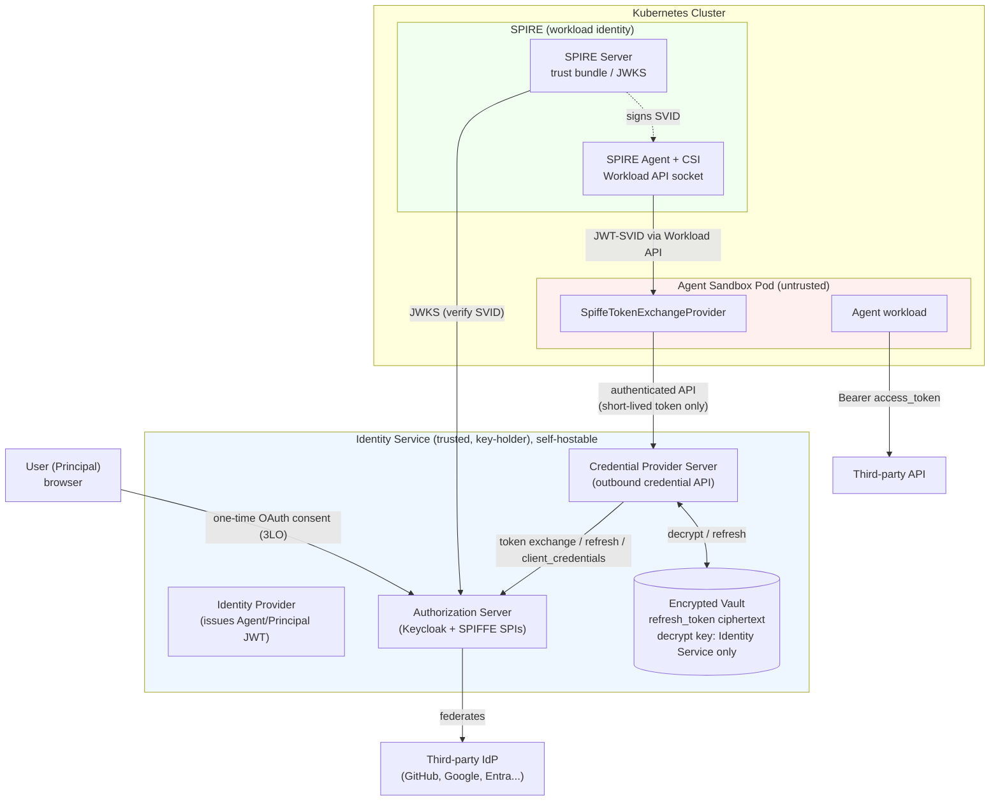
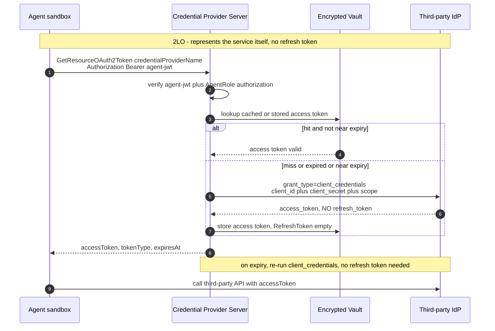
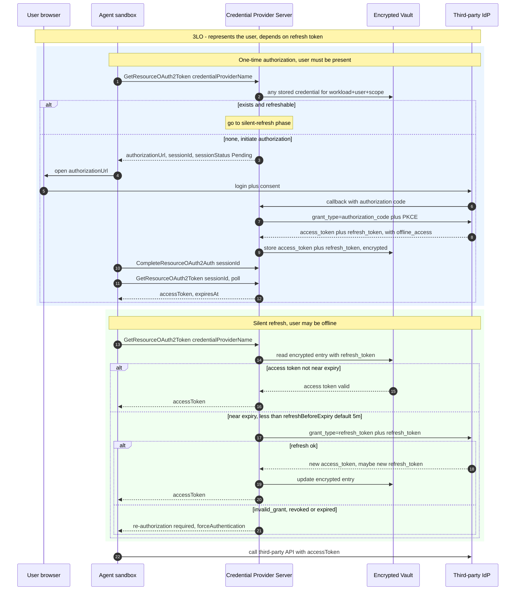
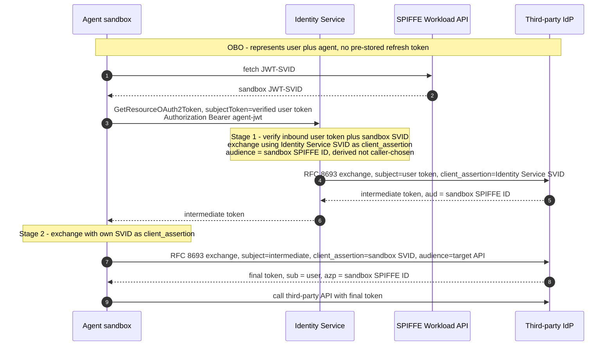

# Agent 动态身份：SPIFFE 工作负载身份与 OAuth 2.0 Token Exchange

> Feature gate: `SecurityIdentityProvider`（Alpha，默认关闭）。

## 目录

- [概要](#概要)
- [动机](#动机)
  - [目标](#目标)
  - [非目标/未来工作](#非目标未来工作)
- [方案](#方案)
  - [用户故事](#用户故事)
  - [架构概览](#架构概览)
  - [协议标准](#协议标准)
  - [实现细节](#实现细节)
    - [核心组件](#核心组件)
    - [SPIFFE Client](#spiffe-client)
    - [Token Exchanger (RFC 8693)](#token-exchanger-rfc-8693)
    - [可信 Principal 派生](#可信-principal-派生)
    - [两阶段 Token Exchange](#两阶段-token-exchange)
    - [出站凭证流（2LO / 3LO / OBO）](#出站凭证流2lo--3lo--obo)
    - [Delegation Store（加密 Vault）](#delegation-store加密-vault)
    - [Inbound Validator](#inbound-validator)
    - [Keycloak SPIFFE SPI](#keycloak-spiffe-spi)
  - [与现有 Identity 框架的集成](#与现有-identity-框架的集成)
  - [部署模式](#部署模式)
  - [Sandbox 注解](#sandbox-注解)
  - [安全模型](#安全模型)
  - [风险与缓解](#风险与缓解)
- [替代方案](#替代方案)
- [测试计划](#测试计划)
- [实现历史](#实现历史)

## 概要

本提案引入一个具体的 `IdentityProvider` 实现，使 Sandbox Agent 能够代表用户
安全地调用第三方 API（例如 GitHub、云服务）。它建立在
[20260427-security-identity-provider.md](./20260427-security-identity-provider.md)
定义的可插拔身份框架之上，并使用两个业界标准协议来实现：

1. **SPIFFE/SPIRE**（CNCF 毕业项目）提供加密的工作负载身份 —— 证明具体是哪个
   Pod 在发起请求。
2. **RFC 8693 OAuth 2.0 Token Exchange** 用于委托凭证获取 —— 将用户授权的
   refresh token 转换为短时效的第三方 access token。

两者结合提供了完整的入站/出站凭证流：Agent 通过 SPIFFE JWT-SVID 证明其身份，
然后通过 OAuth 2.0 授权服务器（例如 Keycloak）用用户委托的 refresh token
换取一个受限范围的第三方 access token。

## 动机

现有的 `IdentityProvider` 接口（`pkg/identity/interface.go`）只有一个默认的
基于 UUID 的实现。虽然框架通过 `RegisterProvider()` 支持可插拔的 provider，
但目前没有一个开源实现能够：

1. 提供**加密的工作负载身份**（当前的 UUID token 可被复制和重放）。
2. 支持**对第三方 API 的委托访问**（Agent 无法代表用户调用 GitHub/云 API）。
3. 支持**可吊销、有时限、受范围限制**的凭证。
4. 与 AWS、Azure、GCP 所使用的**社区标准**（SPIFFE、OAuth 2.0、OIDC）对齐。

### 目标

- 实现一个满足 `IdentityProvider` 接口的 `SpiffeTokenExchangeProvider`。
- 同时支持 SPIFFE 模式（生产环境，配合 SPIRE DaemonSet）和 client-secret 模式
  （serverless/开发回退）。
- 使 Agent 能够通过标准的 RFC 8693 Token Exchange 获取委托的第三方 API token。
- 提供入站 JWT-SVID 校验，用于在 gateway 处验证调用方身份。
- 保持向后兼容：在 `SecurityIdentityProviderGate` 之后默认关闭。
- 提供一个使用 Keycloak 配合自定义 SPI 的参考授权服务器集成。

### 非目标/未来工作

- 定义一个新的 Agent 身份协议（我们采用既有标准：SPIFFE + OAuth 2.0）。
- 替换现有的 gateway UUID 认证机制（JWT gateway 认证由 PR #648 覆盖）。
- 跨信任域的多租户（未来的 SPIFFE Federation 工作）。
- 面向用户的委托管理 Portal UI（应用层关切）。

## 方案

### 用户故事

#### 故事 1：Agent 代表用户调用 GitHub

一位开发者在 Sandbox 中部署了一个编码 Agent。该 Agent 需要在用户的 GitHub
仓库上创建 PR。用户通过 OAuth 同意流程预先授权 Agent。运行时，Agent 获取一个
范围限定为 `repo`、并绑定到其特定 SPIFFE 身份的短时效 GitHub token，然后创建 PR。
该 token 在 8 小时后过期，并由 token 刷新控制器自动刷新。

#### 故事 2：吊销 Agent 访问

一位用户决定吊销某 Agent 对其 GitHub 账户的访问。他们通过授权门户完成此操作。
下次该 Agent 尝试 Token Exchange 时，授权服务器会因委托授予已被吊销而拒绝请求。
Agent 收到明确的错误并停止尝试 API 调用。

#### 故事 3：多 Agent 隔离

两个 Agent（research-agent 和 writer-agent）运行在同一 namespace 但使用不同的
ServiceAccount。各自拥有不同的 SPIFFE ID。即使 research-agent 的 refresh token
意外泄露给 writer-agent，Token Exchange 也会失败，因为委托 scope 绑定到
research-agent 的确切 SPIFFE ID。

### 架构概览

```
                        +-----------------------+
                        |   User (Principal)    |
                        +-----------+-----------+
                                    |
                     Phase 1: OAuth consent + delegation scope
                                    |
                                    v
+----------------+     +------------------------+     +------------------+
|   Portal       |---->|  Authorization Server  |---->|  Third-party IdP |
| (consent flow) |     |  (Keycloak + SPIs)     |     |  (GitHub, etc.)  |
+----------------+     +--------+---+-----------+     +------------------+
                                |   ^
          Phase 2: Token Exchange   |   JWKS verification
          (refresh_token + JWT-SVID)|   |
                                |   |
                                v   |
+-------------------------------+---+----------------------------------+
|                         Kubernetes Cluster                            |
|                                                                      |
|  +------------------+    +-------------+    +-----------+            |
|  | SPIRE Server     |    | SPIRE Agent |    | CSI Driver|            |
|  | (trust bundle,   |    | (DaemonSet, |    | (mounts   |            |
|  |  SVID signing)   |    |  attestation|    |  workload |            |
|  +--------+---------+    +------+------+    |  API sock)|            |
|           |                     |           +-----------+            |
|           | JWKS                | Workload API                       |
|           v                     v                                    |
|  +--------+---------------------+--------+                          |
|  |          Agent Sandbox Pod            |                          |
|  |                                       |                          |
|  |  [SpiffeTokenExchangeProvider]        |                          |
|  |    1. FetchJWTSVID() from SPIRE       |                          |
|  |    2. Read refresh_token from Secret  |                          |
|  |    3. Token Exchange with AuthZ Server|                          |
|  |    4. Cache + return access_token     |                          |
|  |                                       |    Phase 3: API call     |
|  |  [Agent workload] ------------------->+---> Third-party API      |
|  +---------------------------------------+                          |
+----------------------------------------------------------------------+
```

#### 架构（渲染版）



### 协议标准

| 层 | 标准 | RFC/Spec | 用途 |
|-------|----------|----------|---------|
| 工作负载身份 | SPIFFE | [spiffe.io](https://spiffe.io) | 加密的 Pod 身份 |
| 身份文档 | JWT-SVID | [SPIFFE JWT-SVID](https://github.com/spiffe/spiffe/blob/main/standards/JWT-SVID.md) | 短时效的签名身份断言 |
| 客户端认证 | RFC 7523 | [JWT Bearer Assertion](https://datatracker.ietf.org/doc/html/rfc7523) | JWT-SVID 作为 `client_assertion` |
| Token Exchange | RFC 8693 | [OAuth 2.0 Token Exchange](https://datatracker.ietf.org/doc/html/rfc8693) | OBO：用已验证的用户 token 换取第三方 token |
| Authorization Code + PKCE | RFC 6749 §4.1 / RFC 7636 | [OAuth 2.0](https://datatracker.ietf.org/doc/html/rfc6749) / [PKCE](https://datatracker.ietf.org/doc/html/rfc7636) | 3LO：用户同意 → code → access + refresh token |
| Client Credentials | RFC 6749 §4.4 | [OAuth 2.0](https://datatracker.ietf.org/doc/html/rfc6749) | 2LO：服务间 token（无用户，无 refresh token） |
| Resource Indicators | RFC 8707 | [Resource Indicators](https://datatracker.ietf.org/doc/html/rfc8707) | 目标 audience 指定 |
| Discovery | OIDC Discovery | [OpenID Connect](https://openid.net/specs/openid-connect-discovery-1_0.html) | JWKS endpoint 发现 |
| 工作负载身份（IETF） | WIMSE | [IETF WIMSE WG](https://datatracker.ietf.org/group/wimse/about/) | 多系统环境中的工作负载身份 |

#### `aud` 语义（出站 / egress —— 标准优先）

**本文档讨论的是 agent 的*出站*（egress）token 身份 —— agent 向第三方 / 外部服务
出示的 token —— 而非到达 envd 的入站客户端 token**（后者是配套的入站提案，
[`20260725-sandbox-ingress-authn.md`](./20260725-sandbox-ingress-authn.md)）。
由于这些 token 会离开集群、并由我们不控制的**外部鉴权系统**校验,该方向严格遵从
OAuth / OIDC 标准规范,使 `aud` 能与任意标准资源服务器或 IdP 对接互操作。

依据 [RFC 7519 §4.1.3](https://datatracker.ietf.org/doc/html/rfc7519#section-4.1.3)，
`aud` 命名 token 的**预期接收者**；依据
[RFC 8707（Resource Indicators）](https://datatracker.ietf.org/doc/html/rfc8707)，
audience 标识**目标资源服务器**。因此在出站路径上 `aud` 是权威的、优先级更高 ——
它正是外部校验方所检查的:

| Token（本文档，出站） | `aud` = 接收者（权威） | 行为方 |
|---|---|---|
| 阶段 1 中间 token | **sandbox 自身的 SPIFFE ID**（只有该 sandbox 可出示），由已验证的 SVID subject 派生，非调用方选择 | —— |
| 阶段 2 最终 token | **外部目标 API**（校验它的资源服务器，RFC 8707） | sandbox 以 `azp`/授权方出现（RFC 8693） |

出站方向的关键点：**`aud` 是主要的、标准定义的 audience,使 token 能与外部鉴权系统
互操作;sandbox 作为执行交换的授权方以 `azp` 承载（遵从 RFC 8693），而非重载 `aud`。**

> **与入站提案的关系。** 两篇文档处理相反方向,且刻意采用不同的范围界定:
> - **出站（本文档）：** `aud` = 外部服务,标准优先,使 token 无需改造即被外部
>   IdP/资源服务器接受。
> - **入站（入站提案）：** 接收者是 sandbox 自身;主授权锚点是内部的 `sandbox`
>   claim（`sandboxId`+`sandboxUid`,与已合并 verifier 及 #772 对齐），`aud` 作为
>   可选的纵深防御信号。
>
> 保持两者一致的不变量：**`aud` 始终命名"谁被期望接受该 token"** —— 出站是外部
> 服务,入站是 sandbox —— 绝不被重载为别的含义。这消除了此前 `aud` 在两篇文档中
> 看似指向相反方向的不一致。

### 实现细节

#### 核心组件

```
pkg/identity/
├── spiffe/                         # New package
│   ├── provider.go                 # SpiffeTokenExchangeProvider
│   ├── provider_options.go         # Functional options
│   ├── spiffe_client.go            # SPIRE Workload API client
│   ├── token_exchanger.go          # RFC 8693 Token Exchange client
│   ├── delegation_store.go         # K8s Secret reader for refresh tokens
│   ├── token_cache.go              # TTL-based token cache
│   ├── inbound_validator.go        # Inbound JWT-SVID verification
│   └── spiffe_test.go              # Unit tests
│
├── propagator/                     # New package
│   ├── credential_file.go          # Write token to sandbox filesystem
│   └── env_injector.go             # Inject token into Pod env
```

#### SPIFFE Client

SPIFFE Client 封装 SPIRE Workload API 以获取 JWT-SVID：

```go
type SpiffeClient struct {
    socketPath string         // unix:///run/spire/sockets/agent.sock
    authMode   ClientAuthMode // "spiffe" or "client_secret"
}

type ClientAuthMode string
const (
    AuthModeSpiffe       ClientAuthMode = "spiffe"
    AuthModeClientSecret ClientAuthMode = "client_secret"
)

// FetchJWTSVID obtains a JWT-SVID from SPIRE Agent with the given audience.
// The audience MUST be the Authorization Server's realm issuer URL.
func (c *SpiffeClient) FetchJWTSVID(ctx context.Context, audience string) (*JWTSVID, error)
```

SPIFFE ID 格式遵循 SPIRE Kubernetes attestation 模板：
```
spiffe://<trust-domain>/ns/<namespace>/sa/<service-account>
```

#### Token Exchanger (RFC 8693)

Token Exchanger 执行标准的 OAuth 2.0 Token Exchange：

```
POST /realms/{realm}/protocol/openid-connect/token
Content-Type: application/x-www-form-urlencoded

grant_type=urn:ietf:params:oauth:grant-type:token-exchange
&subject_token={user_refresh_token}
&subject_token_type=urn:ietf:params:oauth:token-type:refresh_token
&requested_token_type=urn:ietf:params:oauth:token-type:access_token
&requested_issuer={target_idp}      (e.g., "github")
&scope={requested_scope}            (e.g., "repo")
&client_assertion_type=urn:ietf:params:oauth:client-assertion-type:jwt-bearer
&client_assertion={JWT-SVID}
```

响应：
```json
{
  "access_token": "<third-party-access-token>",
  "token_type": "Bearer",
  "expires_in": 28800,
  "scope": "repo"
}
```

#### 可信 Principal 派生

> **威胁模型注记。** `TokenRequest` 上的 `PrincipalInfo.PrincipalName` 字段
> **绝不能**被当作可信输入。一个调用方可以自由填充的用户身份是一个*断言*，
> 而非*认证*：否则任何能够调用 `IssueToken()` 的组件都可以声称代表任意用户
> 行事，并获取该用户委托的第三方凭证。作为委托交换种子的用户身份**必须
> 从一个经过加密验证的入站凭证派生**，绝不能来自调用方提供的字符串。

**规则：`Principal` 是派生的，不是传入的。** `IdentityProvider` 只有在调用方
已于入站边界被认证后，才接受某个 principal 值，且该 principal 值**必须**等于
已验证入站凭证的 `sub` claim。

参与委托交换的两个身份的信任来源：

| 身份 | 可信来源 | 如何验证 | 绝不 |
|----------|----------------|--------------------|-------|
| **User (Principal)** | 用户出示的入站 OIDC/OAuth access token | JWKS 签名 + `iss` + `aud` + `exp`；`Principal` = 已验证的 `sub` | 由调用方/SDK/sandbox 设置的原始 `PrincipalName` 字符串 |
| **Workload (Sandbox/Agent)** | 来自 SPIRE Workload API 的 SPIFFE JWT-SVID | SPIRE trust-bundle 签名 + `sub`（SPIFFE ID）+ trust-domain 匹配 | 由请求选定的 `sandboxId` 值 |

**谁被允许设置 Principal。** 只有可信的 Identity Service（持有签名/解密密钥的
组件 —— 一个自托管的 Deployment，而非云托管控制平面）才可以绑定 principal，
且仅在其自身已验证入站 OIDC token 之后：

```go
// TRUSTED: the gateway validated the inbound OIDC token first, and the
// principal is the verified subject of that token — not a request field.
claims, err := inboundValidator.VerifyOIDC(ctx, inboundBearerToken) // JWKS + iss/aud/exp
if err != nil {
    return nil, fmt.Errorf("inbound authentication failed: %w", err)
}
req := TokenRequest{
    TokenType: TokenTypePrincipal,
    Principal: &PrincipalInfo{PrincipalName: claims.Subject}, // == verified `sub`
    Sandbox:   sbxInfo,
}
resp, err := provider.IssueToken(ctx, sbx, TokenKindIDToken /* principal-bound */)
```

```go
// UNTRUSTED (rejected): principal taken directly from an unauthenticated field.
// The provider MUST reject a principal that is not backed by a verified inbound
// credential in the current call context.
req := TokenRequest{ Principal: &PrincipalInfo{PrincipalName: userInput} } // ✗ forgeable
```

**强制点。**

1. 当调用上下文中不存在已验证的入站凭证时，`TokenType == Principal` 的
   `IssueToken()` **必须** fail closed（不得静默回退到传入的名字）。
2. 为某用户存储的委托授予（见 [Delegation Store](#delegation-store加密-vault)）
   通过 `delegation:<spiffe-id>` scope 绑定到一个特定的 SPIFFE ID；授权服务器
   在交换时执行**精确匹配（exact match）**，因此即便名字正确的 principal 也
   无法被错误的工作负载行使。
3. 两阶段流中的中间 token audience **从已验证的 Sandbox SVID subject 派生**，
   绝不来自请求参数，因此一个 sandbox 无法铸造一个范围限定为另一个 sandbox 的
   委托 token。

**设计不变式（与既有委托实践对齐）。**

- 用户身份始终源自一个**经过验证的入站 OIDC/JWT 登录**（通过 JWKS 验签、issuer
  和 audience）后才被使用；成为交换的 `subject_token` 的是这个已验证的 token
  —— 绝不是应用层字段。
- 工作负载身份是一个**针对 SPIRE trust bundle 验证过的 SPIFFE JWT-SVID**。
- 该设计**不**将用户原始的 OIDC token 交给 sandbox，也**不**让调用方请求任意的
  中间 audience：中间 audience 从已验证的工作负载 SVID subject 派生，因此工作
  负载无法铸造范围限定为另一身份的 token。

不变式：**用户身份 = 已验证入站凭证的 subject；工作负载身份 = 已验证 SVID 的
subject；交换 audience 从已验证的工作负载身份派生。**

#### 两阶段 Token Exchange

为了在仍能产出一个*同时*携带用户 subject 和 sandbox 作为授权方（authorized
party）的 token 的同时，将用户委托的凭证挡在（不可信的）sandbox 之外，交换被
拆分为跨信任边界的两个阶段。

```
                    ┌──────────────── TRUST BOUNDARY ────────────────┐
  User (OIDC)       │  Identity Service (trusted, key-holder)        │   Sandbox (untrusted)
      │             │                                               │
      │ inbound OIDC │  ① VerifyOIDC(inbound token)  ── JWKS/iss/aud │
      └─────────────┼─► Principal = verified `sub`                   │
                    │                                               │
                    │  ② verify Sandbox SVID (SPIRE JWKS,           │◄── SVID (SPIFFE Workload API)
                    │     trust-domain match)                       │
                    │                                               │
                    │  ③ STAGE 1 exchange (RFC 8693):               │
                    │     subject_token   = verified user token     │
                    │     client_assertion= GATEWAY JWT-SVID        │
                    │     audience        = <derived from verified  │
                    │                        Sandbox SVID subject>  │
                    │            │                                  │
                    │            ▼                                  │
                    │     intermediate token (aud = sandbox SPIFFE) ├──► returned to sandbox
                    │                                               │
                    └───────────────────────────────────────────────┘
                                                                    │  ④ STAGE 2 exchange (RFC 8693):
                                                                    │     subject_token   = intermediate token
                                                                    │     client_assertion= SANDBOX JWT-SVID
                                                                    │     audience/scope  = target API
                                                                    │            │
                                                                    │            ▼
                                                                    │     final token
                                                                    │     (sub = user, azp = sandbox SPIFFE)
                                                                    │  ⑤ inject Authorization: Bearer → target API
```

**为什么分两阶段（以及为什么用户 token 从不进入 sandbox）：**

- **用户的委托凭证以加密形式（信封加密）保存，解密密钥仅由可信的 Identity
  Service 持有**，它是唯一在 Stage 1 内部解密并将其用作 `subject_token` 的组件。
  sandbox 永远看不到 refresh token —— 它只通过一个经过认证的 API 接收短时效
  token（见 [Delegation Store](#delegation-store加密-vault)）。这消除了用户
  `refresh_token` 在 sandbox 内可读的风险，并注意该保证来自**解密密钥的托管，
  而非 namespace 布置或任何云托管控制平面**（vault Secret 可以与 sandbox 共享
  namespace，且 Identity Service 是一个可自托管的工作负载）。
- Stage 1 产出一个**其 audience 为 sandbox 自身 SPIFFE ID 的中间 token**，因此
  它只能被该特定 sandbox 使用。该 audience 从*已验证的* SVID subject 派生
  （上面的强制点 3），而非由调用方选择。
- Stage 2 是一次**由 sandbox 执行的标准 RFC 8693 交换**，使用其自身的 SVID
  作为 `client_assertion`、中间 token 作为 `subject_token`，产出一个最终 token，
  其中 `sub` = 用户、`azp`/授权方 = sandbox SPIFFE ID。

**部署变体 —— 注入时绑定（单个运行时跳）。** 因为 openkruise/agents 从一个可信的
operator/Identity Service 将出站 `IDToken` 注入 sandbox（写入 runtime，不放在
CR 上），所以 Stage 1 **可以**在**注入时**由该可信组件在其验证了用户入站 OIDC
身份之后执行。在该变体中，sandbox 收到一个已经与用户绑定的 `IDToken`，并只在
运行时执行单次 Stage-2 交换。安全性与两跳流等价 —— 用户凭证仍从不进入 sandbox，
绑定仍由一个已验证用户身份、持有密钥的可信组件完成 —— 同时避免了每请求一次的
往返。"运行时两跳"与"注入时绑定单跳"之间的选择是部署模式决策，而非对信任模型
的改变。

> **注入变体的护栏：** *触发*注入的组件在请求 principal 绑定的 `IDToken` 之前，
> **必须**自身已验证用户的入站 OIDC 身份；否则伪造风险只是从 `Principal` 字段
> 转移到了注入触发处。

#### 出站凭证流（2LO / 3LO / OBO）

系统为 agent 获取第三方凭证暴露了三种 OAuth 2.0 授权流。它们的差异在于
**token 代表谁**以及**是否涉及 refresh token**。

| 流 | Grant | 代表 | 用户交互 | Refresh token | 过期时 |
|------|-------|-----------|------------------|---------------|-----------|
| **2LO** | `client_credentials` | 服务自身 | 无 | **不使用** | 用 client secret 重新获取（无状态） |
| **3LO** | `authorization_code`（+ PKCE） | **用户**（委托） | 一次性浏览器同意 | **必需**（配合 `offline_access`） | 静默刷新；回退到重新同意 |
| **OBO** | RFC 8693 token-exchange | **用户 + agent**（组合） | 无（使用入站 token） | 不预存 | 从入站 `subject_token` 重新交换 |

在所有流中：agent 用其 Agent JWT（`Authorization: Bearer`）向 Credential
Provider Server 认证，由 AgentRole/AgentRoleBinding 授权，并**仅接收一个短时效
的 access token** —— 长时效物料（client secret、refresh token）由 Identity
Service 加密持有（见 [Delegation Store](#delegation-store加密-vault)）。

##### 2LO —— Client Credentials（无 refresh token）



##### 3LO —— Authorization Code + PKCE（需要 refresh token）



##### OBO —— On-Behalf-Of Token Exchange（RFC 8693，组合身份）

这就是 [两阶段 Token Exchange](#两阶段-token-exchange) 流，此处以相同记法展示
以便对比。它在最终 token 中携带**用户 + agent**身份，且无需任何预存的
refresh token。



**如何选择一个流：** 当 agent 以自身身份行事（服务间、无用户）时用 **2LO**；
当 agent 必须为一个只授权一次随后可能离线的用户行事时（后台/长时运行工作 ——
vault 中的 refresh token 使其持续运行）用 **3LO**；当请求中已存在一个已验证的
用户 token、且下游服务必须在一个 token 中同时看到用户（`sub`）和行事的 agent
（`azp`）时用 **OBO**。

#### Delegation Store（加密 Vault）

用户委托的 refresh token 是**长时效凭证**，**绝不能**被（不可信的）sandbox
读取。这里的信任边界**不**画在 Kubernetes namespace 上，也**不**依赖任何云托管
控制平面 —— 它画在**谁持有解密密钥**上。该 store 是一个由 Kubernetes Secret
支撑的信封加密抽象（"vault"）。

> **术语。** 本文中持有密钥的可信组件被称为 **Identity Service** —— 即持有
> 签名/解密密钥并暴露凭证 API 的工作负载（在参考实现中为 identity-provider 和
> credential-provider 服务器）。它是一个普通的、**可自托管的 Kubernetes
> Deployment**；该术语并不意味着某个云厂商的托管控制平面。下面的安全属性源自
> *该组件对密钥的托管*，无论它运行在哪里。

**存储模型（如参考 Identity Service 中所实现）：**

1. **写入前信封加密。** refresh token 在被写入 Secret 前，用一对非对称密钥加密。
   因此 Secret 中包含的是密文，而非 base64 的明文 token。

   ```yaml
   apiVersion: v1
   kind: Secret
   metadata:
     # Name derived from a vault key that binds workload + user + scope, e.g.
     #   SHA256(namespace, credentialProvider, grantType, workloadHash, userHash, scopeHash)
     name: <vault-name-prefix>-<hash>
     # Namespace follows the CredentialProvider CR's namespace (typically the
     # user/business namespace) — it is NOT a dedicated/privileged namespace.
     namespace: <credentialprovider-cr-namespace>
     ownerReferences:
       - kind: CredentialProvider
         name: <cr-name>            # GC-bound to the CR
   type: agentidentity.alibabacloud.com/oauth2-vault-entry
   data:
     payload: <envelope-encrypted-refresh-token-and-metadata>   # ciphertext
   ```

2. **解密密钥只存在于 Identity Service 中。** 加密密钥对从仅挂载到 Identity
   Service 工作负载（identity/credential provider 服务器）的文件加载，例如
   `/etc/agent-identity/token/token-encrypt-key.pem`（私钥）和
   `token-encrypt-pub-key.pem`（公钥）。**没有任何 sandbox/agent 代码路径加载
   私钥。** 即使一个 sandbox 与 CR 共享 namespace 并能 `get secret` 到 vault
   条目，它取到的也只是无法解密的密文。（该密钥是文件挂载，因此私钥可以来自
   一个受 RBAC 限制的 Secret、一个 CSI secret driver，或一个 KMS/HSM —— 这些
   都不需要云托管控制平面。）

3. **agent 从不接触 refresh token。** sandbox 只能通过 Identity Service 上一个
   经过认证的 HTTP API 获取出站凭证（`POST /api/v1/credentials`，带
   `x-api-action-name: GetResourceOAuth2Token` 和
   `Authorization: Bearer <agent-jwt>`）。该服务认证调用方、解密 vault 条目、
   执行刷新/交换，并**仅返回一个短时效的 access token**（响应视图从不包含
   refresh token）。refresh token 从不出现在 API 响应、日志或指标中。

4. **由 Identity Service 静默刷新。** 当 access token 临近过期
   （`RefreshBeforeExpiry`）时，Identity Service 使用存储的 refresh token 获取
   一个新的 access token（通过 singleflight 收敛并发）。这正是支撑离线委托场景
   （见下）的机制：用户可以离线而 agent 仍持续运行，因为长时效凭证及其刷新
   周期完全存在于 Identity Service 内部。

**绑定。** refresh token 携带一个 `delegation:<spiffe-id>` scope，由授权服务器
在交换时通过**精确匹配**强制执行；此外 vault key 自身将条目绑定到
`(workload, user, scope)`，因此一份被泄露的密文即使在尝试解密之前，对不同的
workload 也毫无用处。

> **正确的安全表述（不要转述为"存储在控制平面 namespace 中"或"由云控制平面
> 保护"）：** refresh token 以**信封加密的密文形式存储在一个 Kubernetes Secret
> 中（namespace 跟随 CredentialProvider CR）**；**解密密钥仅由可信的 Identity
> Service（一个可自托管的工作负载）持有**；且 **agent 只能通过一个经过认证的
> API 获取短时效 access token，永远看不到 refresh token**。安全性源自
> **解密密钥托管 + 加密 + 仅 API 访问** —— 而非 namespace 隔离，也非任何
> 云厂商托管的控制平面。

**委托模型（两种互补范式）。** 本设计同时支持：

| 模型 | 用户何时 | 凭证 | 如何 |
|-------|--------------|------------|-----|
| **在线 / 请求时（OBO）** | 在场（token 在请求中） | 请求时将已验证的入站用户 token 用作 `subject_token` | RFC 8693 token exchange，无任何预存 |
| **离线 / 预存委托** | 不在场（离线） | 一次性预授权的长时效 refresh token（3LO 同意 + `offline_access`），加密存储在 vault 中 | Identity Service 静默刷新；agent 按需获得短时效 token |

**离线模型**让 agent 能在用户离线时代表用户行事（故事 1 的自动刷新 GitHub
token；长时运行的后台 agent），这是纯请求时（在线）模型无法做到的。代价是一个
长时效凭证，而这正是它要在由 Identity Service 托管的密钥下加密持有、绝不进入
sandbox 的原因。

#### Inbound Validator

用于在 gateway/traffic-extension 层验证入站请求：

1. 解析 JWT header，提取 `kid`
2. 从 SPIRE Server JWKS endpoint 获取公钥（已缓存）
3. 验证 RSA/ECDSA 签名
4. 校验 `sub`（SPIFFE ID）是否匹配允许的模式
5. 校验 `aud` 是否包含目标服务
6. 检查 `exp` 是否过期

#### Keycloak SPIFFE SPI

授权服务器需要自定义扩展来桥接 SPIFFE 与标准 OAuth 2.0。对于 Keycloak，
这涉及三个自定义 SPI：

| SPI                           | 用途                                                                                                            | 弥补的差距                                            |
| ----------------------------- | ------------------------------------------------------------------------------------------------------------------ | -------------------------------------------------------- |
| `SpiffeClientAuthenticator`   | 校验 JWT-SVID 作为 `client_assertion`；通过 `spiffe.id.pattern` 属性将 SPIFFE ID 映射到 Keycloak client      | Gap 1：SVID 格式不同于标准 JWT client auth |
| `SpiffeIdDelegationValidator` | 从 subject_token 提取 `delegation:<spiffe-id>` scope；对请求方的 SPIFFE ID 执行**精确匹配** | Gap 5：委托 scope 的 SPIFFE ID 校验             |
| `AudienceEnforcerMapper`      | 将 `audience` 注入 token 的 `aud` claim（在 Keycloak 26.8 实现 RFC 8707 之前的权宜之计）                     | Gap 4：缺失 Resource Indicators                       |

额外的运维配置：
- **Gap 2**（SPIFFE ID 到 Client 的映射）：通过在 Keycloak client 属性中存储
  `spiffe.id.pattern` glob 解决。
- **Gap 3**（SPIRE Trust Bundle 同步）：通过将 Keycloak 的 JWKS URL 指向
  SPIRE Server 的 `/keys` endpoint 解决。
- **Gap 6**（Token 吊销）：可选的 `TokenRevocationMapper` 为已吊销的委托授予
  阻止 token 签发。

### 与现有 Identity 框架的集成

该实现在对现有调用方零改动的情况下集成：

```go
// Registration at startup (gated by SecurityIdentityProviderGate)
func init() {
    if features.DefaultFeatureGate.Enabled(features.SecurityIdentityProviderGate) {
        provider, _ := spiffe.NewSpiffeTokenExchangeProvider(
            spiffe.WithTokenEndpoint(os.Getenv("TOKEN_EXCHANGE_ENDPOINT")),
            spiffe.WithRealmIssuer(os.Getenv("REALM_ISSUER")),
            spiffe.WithSpireSocketPath(os.Getenv("SPIFFE_ENDPOINT_SOCKET")),
            spiffe.WithAuthMode(spiffe.ClientAuthMode(os.Getenv("CLIENT_AUTH_MODE"))),
        )
        identity.RegisterProvider(provider)
    }
}
```

现有调用点在不改变签名的前提下即可编译并被调用：

- **`identity.IssueToken()`** —— 直接沿用；SPIFFE provider 像其他 provider 一样
  从 `sbx` 构造其 wire request。
- **`identity.PropagateSecurityToken()`** —— *调用点*不变，但需注意：在社区模式下
  `defaultTokenProvider.PropagateSecurityToken` 是 **no-op**，且没有注册任何
  propagator，因此由已注册的 SPIFFE provider 签发的 token **不会**自行送达
  sandbox。把 token 送达工作负载是一块**必需且独立**的工作 —— 它**不**由"无需修改
  即可工作"所蕴含。

  **设计原则：凭据不得作为长期密钥落入不可信的 sandbox。** 因此传播（propagation）
  被刻意留给后续的 **envd 架构拆分**（一个可信的 Pod 内组件，向 agent 进程分发
  短时效 token）来实现，而不是把凭据写入 sandbox 的文件系统/环境变量。该传播路径
  的相关工作已在进行中 —— 见 [#787](https://github.com/openkruise/agents/pull/787)
  —— 本提案仅将其作为相关工作引用，而非声称该路径已经存在。

### 部署模式

| 模式 | 是否需要 SPIRE | 客户端认证 | 适用场景 |
|------|----------------|----------------------|----------|
| `spiffe`（默认） | 是（DaemonSet + CSI） | 来自 SPIRE Workload API 的 JWT-SVID | 生产 Kubernetes |
| `client_secret` | 否 | 来自 K8s Secret 的 `client_id` + `client_secret` | ACK Serverless (ECI)、开发、CI |

### Sandbox 注解

```yaml
metadata:
  annotations:
    security.agents.kruise.io/delegation-secret: "user-alice-delegation"
    security.agents.kruise.io/target-issuer: "github"
    security.agents.kruise.io/target-scope: "repo"
    security.agents.kruise.io/auth-mode: "spiffe"
```

### 安全模型

| 属性 | 机制 |
|----------|-----------|
| **用户身份不可伪造** | `Principal` 从已验证入站 OIDC token 的 `sub` claim 派生（JWKS + `iss`/`aud`/`exp`），绝不来自调用方提供的字段（见 [可信 Principal 派生](#可信-principal-派生)） |
| **用户凭证从不进入 sandbox** | 用户 token 留在可信的 Identity Service（密钥持有者）内部，仅用作 Stage-1 `subject_token`；sandbox 始终只持有一个范围限定为 sandbox 的中间/ID token（见 [两阶段 Token Exchange](#两阶段-token-exchange)） |
| **中间 audience 不可伪造** | Stage-1 中间 audience 从*已验证的* Sandbox SVID subject 派生，而非来自请求参数，因此 sandbox 无法为另一个 sandbox 铸造委托 token |
| **工作负载身份不可伪造** | SPIFFE JWT-SVID 由 SPIRE 通过内核级 Pod attestation（k8s_psat）签发 |
| **委托绑定** | refresh_token 中的 `delegation:<spiffe-id>` scope；授权服务器执行**精确匹配**（非 glob） |
| **跨 agent 隔离** | SPIFFE ID 编码 `ns/{namespace}/sa/{serviceAccount}`；不同 Agent 有不同的 ID |
| **最小权限** | 强制 scope 降级；Agent 无法请求比用户授权更宽的 scope |
| **可吊销** | 用户吊销委托 → 授权服务器拒绝后续 Token Exchange |
| **审计线索** | 交换出的 token 包含 `act.sub` claim，记录哪个 Agent 代表用户行事 |
| **有时限** | 短时效 token（默认 8h）；通过 `securitytokenrefresh` controller 自动刷新 |
| **Fail-closed** | 缺失 SPIRE socket、缺失 Secret、未验证的入站身份或失败的 Token Exchange → 错误传播，无静默回退 |

### 风险与缓解

| 风险 | 影响 | 缓解 |
|------|--------|------------|
| **伪造 `Principal`（用户冒充）** | 调用方设置一个任意的 `PrincipalName` 并获取另一用户的委托凭证 | `Principal` **必须**从已验证入站 OIDC token 的 `sub` 派生；若调用上下文中无已验证入站凭证，`IssueToken(TokenType=Principal)` fail closed；只有可信的 Identity Service（入站验证之后）可绑定 principal —— 见 [可信 Principal 派生](#可信-principal-派生) |
| **中间 token audience 伪造** | 一个 sandbox 请求一个范围限定为*另一个* sandbox 的中间 token | Stage-1 audience 从已验证的 Sandbox SVID subject 派生，而非任何请求字段；Stage-2 校验中间 token 的 audience 是否匹配其自身 SVID |
| SPIRE Server 不可用 | Agent 无法获取 JWT-SVID；token 签发失败 | 带退避重试；非 DaemonSet 环境用 client_secret 回退模式 |
| Vault Secret 被同处（同 namespace）的 sandbox 读取 | sandbox 可能尝试读取存储的 refresh token | Vault 条目是**信封加密**的；**解密密钥仅挂载到 Identity Service 工作负载**（无 sandbox 代码路径加载私钥），因此同处 sandbox 只能读到密文。Agent 只能通过返回短时效 access token 的认证 API 获取凭证；refresh token 从不出现在响应/日志/指标中（见 [Delegation Store](#delegation-store加密-vault)）。保证来自**密钥托管**，而非 namespace 隔离。 |
| 解密密钥泄露 | 攻击者可解密所有 vault 条目 | 私钥通过文件（`/etc/agent-identity/token/token-encrypt-key.pem`）仅挂载到 Identity Service pod，受 pod/Secret RBAC 限制；密钥来源可插拔（受 RBAC 限制的 Secret、CSI secret driver 或 KMS/HSM）且可自托管；未来：KMS/HSM 支撑的密钥、轮转 |
| 授权服务器不可用 | Token Exchange 失败 | 缓存的 token 在过期前仍有效；带退避重试 |
| JWKS 密钥轮转 | 入站校验器拒绝新 token | 对未知 `kid` 惰性刷新；可配置的 JWKS 缓存 TTL |
| Secret 中长时效的 refresh_token | Secret 泄露时的暴露窗口 | 未来：集成外部 secret store（Vault、ESO）；短 TTL + 轮转 |

## 替代方案

| 替代方案                      | 未被选择的原因                                                                               |
| -------------------------------- | -------------------------------------------------------------------------------------------- |
| **AgentID (agentscope-ai)**      | Agent 自管私钥；无工作负载 attestation；无委托机制            |
| **纯 K8s SA Token projection** | 无第三方 API 委托；仅限 GCP/AWS federation                            |
| **E2B 风格的每 team API Key**   | 无按用户委托；无工作负载身份；无吊销                                  |
| **自定义私有协议**  | 不可互操作；社区标准更优                                             |
| **在 Agent 中直接做 GitHub OAuth** | Agent 持有长时效用户凭证；违反最小权限；无集中吊销 |

## 测试计划

### 单元测试
- `SpiffeClient`：Mock SPIRE Workload API；验证 JWT-SVID 获取与缓存。
- `TokenExchanger`：Mock HTTP server；验证 RFC 8693 请求格式与响应解析。
- `DelegationStore`：Mock K8s client；验证 Secret 读取与错误处理。
- `TokenCache`：验证 TTL 过期、sandbox 隔离与逐出。
- `InboundValidator`：验证签名校验、audience 检查、过期检查以及 SPIFFE ID
  模式匹配。

### 集成测试（E2E）

| 阶段 | 场景 | 验证内容 |
|-------|-----------|-------------------|
| Phase 1（预授权） | 用户同意流、委托 scope 签发、refresh_token 存储 | OIDC 流正确性、scope 绑定 |
| Phase 2（Token Exchange） | SPIFFE 认证、Token Exchange、第三方 token 获取 | RFC 8693 合规、委托校验 |
| 失败场景 | 无效 refresh_token、已吊销委托、SPIFFE ID 不匹配、授权服务器不可用 | 错误处理、fail-closed 行为 |
| 安全场景 | 跨 agent token 复用尝试、scope 提权尝试 | 隔离与最小权限强制 |
| Principal 信任场景 | 无入站 token 时伪造/调用方提供的 `Principal`、`Principal` 与已验证入站 `sub` 不匹配、sandbox 请求另一 sandbox audience 的中间 token、两阶段交换后 sandbox 文件系统中不存在用户 token | 可信 principal 派生、对未验证入站身份 fail-closed、中间 audience 绑定、用户凭证限制 |
| 出站流覆盖 | 2LO 过期时 client_credentials 重取（无 refresh token）；3LO 同意 → code → refresh、过期前静默刷新、`invalid_grant` 时重新同意；OBO 两阶段交换 | 每种流的正确 grant、refresh-token 仅在 3LO 中出现、仅向 agent 返回短时效 token |

### E2E 基础设施
- Docker-compose 环境：Keycloak + PostgreSQL + SPIRE Server/Agent + Mock 第三方 IdP
- Python pytest 框架用于流验证
- 模拟 OAuth authorization code 流和 API 认证的 Mock 第三方服务器

## 实现历史

- 2026-07-25：初版提案起草
- 2026-07-25：新增可信 Principal 派生与两阶段 Token Exchange 章节 —— 确立
  `Principal` 必须从已验证入站 OIDC 凭证派生（而非调用方提供的字段）、用户凭证
  留在可信的 Identity Service 内部且从不进入不可信的 sandbox、以及 Stage-1 中间
  audience 从已验证的 Sandbox SVID 派生。新增注入时绑定的单跳部署变体。
- 2026-07-25：修正 Delegation Store 安全模型以匹配已验证的参考实现 —— refresh
  token 是**存储在一个 namespace 跟随 CredentialProvider CR（可与 sandbox 同处）
  的 K8s Secret 中的信封加密密文**，且信任保证来自 **Identity Service 对解密
  密钥的托管 + 仅返回短时效 token 的 API 访问**，而非 namespace 隔离。新增两种
  互补的委托模型（在线/OBO 请求透传 vs 离线/预存 vault 刷新）。
- 2026-07-25：术语 —— 全文将"control plane"替换为 **Identity Service**（一个
  可自托管、持有密钥的 Kubernetes Deployment），以明确 refresh-token 安全模型
  依赖于**解密密钥托管**，而非任何云厂商托管的控制平面。澄清私钥来源可插拔
  （受 RBAC 限制的 Secret / CSI / KMS / HSM）。
- 2026-07-27：新增渲染版 Mermaid **架构图** 和一个新的 **出站凭证流
  （2LO / 3LO / OBO）** 章节，含三张 Mermaid 时序图和一张流对比表。澄清
  **refresh token 仅在 3LO 中使用**（2LO 通过 client_credentials 重取；OBO
  重新交换入站 subject token）。将 `authorization_code`+PKCE 和
  `client_credentials` 加入协议标准，并在 E2E 测试计划中新增一行出站流覆盖。
- [待定]：社区评审
- [待定]：实现 `pkg/identity/spiffe/` 包
- [待定]：Keycloak SPI 参考实现
- [待定]：E2E 测试套件
